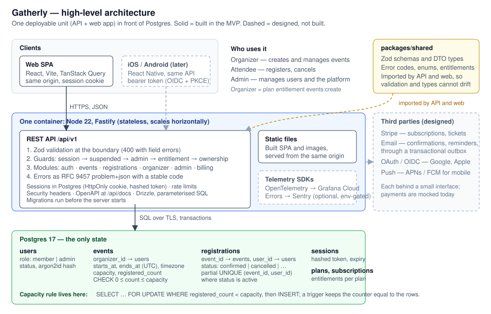

# Gatherly

A community events platform: organizers create events with a capacity, attendees reserve and release seats, administrators manage users. Built for the Jobsite911 platform engineering assessment.

The brief's workflow (create an event with a date, time and capacity → register → refuse once full → cancel frees the seat) is implemented as a REST API on Postgres, race-safe under concurrent registrations, and covered by integration tests. The rest of the repository (web app, search, personalized feed, telemetry) is listed under [Beyond the brief](#beyond-the-brief).

| | |
|---|---|
| Live demo | [gatherly--khanovicdev.replit.app](https://gatherly--khanovicdev.replit.app) — free hosting, a few seconds of cold start; sign in as a demo persona (organizer, attendee, admin) |
| API reference | [/api/docs](https://gatherly--khanovicdev.replit.app/api/docs), generated from the Zod schemas that validate requests |
| Architecture | [docs/architecture.md](docs/architecture.md) — diagrams, data model, access control, scaling, security, integrations, mobile |

## Run it

Prerequisite: Docker.

```bash
docker compose up
```

Open [localhost:3000](http://localhost:3000). Migrations and the demo seed run automatically. Set `APP_PORT` or `DB_PORT` if 3000 or 54329 are taken.

Development with hot reload (Node 22.12+, pnpm 9 via `corepack enable`):

```bash
cp .env.example .env && docker compose up -d db && pnpm install && pnpm db:migrate && pnpm dev
```

Tests run against the `gatherly_test` database the Compose file creates:

```bash
docker compose up -d db && pnpm test
```

`pnpm lint` and `pnpm typecheck` run the same checks as CI.

## Architecture



- **One deployable unit.** A Fastify API under `/api/v1` that also serves the built React app from the same origin. Stateless: sessions live in Postgres, so instances can be added freely.
- **Postgres is the only state**, and it enforces the rules that matter most: capacity (check constraint), one active registration per user and event (partial unique index), event time ordering.
- **`packages/shared`** holds the Zod schemas, types and error codes used by both API and web, so request validation, form validation and the OpenAPI document come from one definition.
- **Clients** call the same versioned API. The web app uses a session cookie; the designed mobile apps (React Native) would use a bearer token issued through OIDC with PKCE.
- **Three user types** map to two layers: a `role` (`member` or `admin`) and a plan entitlement (`events:create` makes a member an organizer). Ownership (`event.organizer_id`) is the third check. See [ADR 0005](docs/adr/0005-authorization-model.md) for why organizer is not a role.
- **Third parties** (Stripe, email, OAuth, push) are designed behind small interfaces and not built; the payment provider is mocked.

Stack: TypeScript end to end — Fastify, Zod, Drizzle, Postgres 17, React. One language and one schema package for API, web and later mobile; Postgres does capacity, sessions and search without extra infrastructure. Decisions and their tradeoffs are recorded as short [ADRs](docs/adr/README.md).

## The brief's workflow

| Step | Endpoint | Rule | Error |
|---|---|---|---|
| 1. Organizer creates an event | `POST /api/v1/events` | Needs the `events:create` entitlement; UTC start and end plus an IANA time zone; capacity 1–10,000; start in the future | `ENTITLEMENT_REQUIRED`, `VALIDATION_FAILED` |
| 2. Attendee registers | `POST /api/v1/events/:id/registrations` | Signed-in user; one active registration per event | `ALREADY_REGISTERED`, `EVENT_STARTED`, `EVENT_CANCELLED`, `EVENT_BUSY` |
| 3. Capacity reached | same | Locking conditional read matches no row | `409 EVENT_FULL` |
| 4. Attendee cancels | `DELETE /api/v1/events/:id/registrations/me` | Soft-cancel keeps history; the seat is released; re-registering is allowed | `NOT_REGISTERED`, `EVENT_STARTED` |

**How capacity is enforced** ([seats.ts](apps/api/src/modules/registrations/seats.ts), [migration 0003](apps/api/drizzle/0003_seat_count_trigger.sql), [ADR 0006](docs/adr/0006-capacity-concurrency.md)). Registration is one transaction: `SELECT … FROM events WHERE id = ? AND status = 'published' AND registered_count < capacity AND starts_at > now() FOR UPDATE`, then `INSERT` the registration. The locking read serializes concurrent requests on the event row, and Postgres re-checks the conditions for a request that had to wait; the second request for the last seat matches nothing and gets `EVENT_FULL`. The registration row *is* the seat: a database trigger moves `registered_count` on every insert, status change or delete of a seat-holding row, so no handler, cascade or manual fix can make the counter and the rows disagree, and `GET /admin/integrity/seats` proves it. A duplicate registration violates the partial unique index and rolls back. Cancel is the mirror image; both paths lock the event row before the registration row, so they cannot deadlock. "Has it started" is evaluated on the database clock everywhere. A `lock_timeout` turns a stampede on one event into `503 EVENT_BUSY` (retry) rather than a stalled connection pool. A check constraint (`0 ≤ registered_count ≤ capacity`) is the last line of defence.

**Validation and errors.** Zod schemas at the API boundary (shared with the web forms), database constraints as a backstop, and RFC 9457 `problem+json` responses with a stable `code` clients can branch on. Error codes per endpoint: [docs/api.md](docs/api.md).

**Role-based authorization** is implemented, not only described: `requireUser`, `requireAdmin`, `requireEntitlement` and `assertOwnerOrAdmin` in [guards.ts](apps/api/src/lib/guards.ts), checked in a fixed order (session → suspended → admin bypass → entitlement → ownership). The UI mirrors them for usability only. Full [permission matrix](docs/architecture.md#permission-matrix).

**Tests** ([apps/api/test](apps/api/test), Vitest against a real Postgres): the brief's workflow end to end through the HTTP layer; 25 parallel registrations for 10 seats ending with exactly 10 confirmations and 15 `EVENT_FULL`; 20 members each registering, cancelling and registering again at once for 8 seats, ending with the counter equal to the rows; a deleted member's seat released by the trigger; a held event row answering `EVENT_BUSY`; the drift check empty; an error-path table (started, cancelled, duplicate, not registered, wrong organizer); authorization per role.

## Assumptions, limitations, tradeoffs

| Assumption | Effect |
|---|---|
| Organizing is a paid capability (Premium); attending is free | Organizer is a plan entitlement an admin can grant, not an account type |
| Events are free for now | Price fields exist; a price above zero is rejected with `PAID_TICKETS_UNAVAILABLE` |
| Registration closes when the event starts; no waitlist | `EVENT_STARTED` after start; a full event refuses new registrations |
| Events start within two years and last at most seven days | Keeps typos out of discovery |

| Limitation | Why acceptable now | Upgrade path |
|---|---|---|
| In demo mode anyone can act as admin | Reviewers need every role instantly; personas are protected and real accounts are read-only | `DEMO_MODE` off in production; admins through an identity provider with MFA |
| No email verification or password reset | Enough to keep each visitor's own preferences | Email through an outbox, then hosted identity or OAuth |
| Rate limits counted per instance, in memory | Cheap brute-force protection on one instance | Shared store (Redis) before a second instance |
| Migrations run at container start | One instance, no race | Separate migration job before more than one instance can start |
| Tests need a running Postgres | Integration tests are the ones that prove the capacity rule | Testcontainers so `pnpm test` self-provisions |
| One environment, no staging; mobile apps are architecture only | Zero-cost hosting; the API is versioned and client-agnostic | Staging and production; native clients on the same API |

| Chose | Over | Because |
|---|---|---|
| Locking read on a counter column that a trigger maintains | `SELECT … FOR UPDATE` then `COUNT(*)` of the rows | Same guarantee without a count on every read; the counter cannot drift because the database moves it, not each code path |
| Database-enforced capacity | Queues, Redis counters or advisory locks | Correct under concurrency with no extra moving parts |
| Server-side sessions in Postgres | Stateless JWTs | Instant revocation (suspend, sign-out) with no extra store |
| One process serving API and web | Separate frontend hosting | One deployment, same origin, no CORS or cross-site cookies |

The known cost of the counter design: all registrations for one event serialize on one row, which caps throughput for a single very hot event. The `lock_timeout` keeps that from spreading to the rest of the platform; the next step is a waiting room or split seat inventory, with the signal to act in [ADR 0006](docs/adr/0006-capacity-concurrency.md).

## Before production

In order of the damage each gap could do; details and triggers in [docs/roadmap.md](docs/roadmap.md).

1. **Data:** managed Postgres with point-in-time recovery and a restore drill; migrations as a separate job; expand-and-contract migration rules.
2. **Identity:** `DEMO_MODE` off; email verification and password reset; OIDC sign-in; MFA and an audit log for admins.
3. **Abuse:** shared rate-limit store; per-account registration caps and bot protection on high-demand events.
4. **Privacy:** account deletion that anonymizes registrations, data export, enforced retention.
5. **Operations:** staging, warm instances, SLO alerts, rollback runbook.
6. **Product:** email confirmations through an outbox, then a waitlist.

## Beyond the brief

The assessment asks for a backend and documentation. These parts go further; each is separable and none is on the path of the core workflow.

| Addition | What | Why it is here |
|---|---|---|
| Web app ([apps/web](apps/web)) | React SPA: discover, event detail, my tickets, organizer dashboard, admin console, onboarding | Lets a reviewer try every role in a browser; the API is the security boundary, the UI only mirrors it |
| Search and discovery | Postgres full-text search with typo tolerance, distance and date filters | Finding events is the product's front door; done in Postgres to avoid a search cluster |
| Rule-based "For you" feed | Versioned ranker behind an interface, reasons on every card, impressions logged | Shows how personalization would be introduced safely: explainable rules now, a learned model later without API changes ([ADR 0009](docs/adr/0009-rule-based-ranker.md), [0010](docs/adr/0010-interaction-data.md)) |
| Telemetry | OpenTelemetry traces, logs and metrics to Grafana Cloud; errors to Sentry; one trace ID from browser to database | Production habits from day one; public [Grafana dashboard](https://lankyholly1972.grafana.net/public-dashboards/9402737b590a4f538536e6057470aeba) and a shared [Sentry issue](https://khandev-s1.sentry.io/share/issue/25e21197641d4401a8ebfddb8027efa0/) need no account ([docs/observability.md](docs/observability.md)) |
| Demo mode | Persona sign-in, protected accounts, scoped demo reset, realistic seed | A public demo that stays usable and keeps real sign-ups safe |
| Payment-ready schema and monetization design | Plans, entitlements, registration statuses for holds and refunds; the paywall; [docs/monetization.md](docs/monetization.md) | Makes paid tickets additive rather than a rewrite; nothing charges money today |
| Operations and roadmap docs | [Operations](docs/operations.md), [roadmap](docs/roadmap.md), production topology ([ADR 0011](docs/adr/0011-production-topology.md)) | Answers the "how would you take this to production" discussion in writing |

## AI tooling disclosure

AI coding assistants were used throughout: to scaffold boilerplate (Fastify plugins, Drizzle schema wiring, React pages), draft tests and documentation, and review changes for mistakes. The architecture, the capacity and locking design, the authorization model and the decision records are my own design choices; every generated piece was read, adjusted and run before it was committed, and I can explain any part of the repository.

## Documentation

| Document | Covers |
|---|---|
| [Architecture](docs/architecture.md) | Brief at a glance, system context, request flow, data model, access control, scaling, security, integrations, mobile, production topology |
| [API](docs/api.md) | Endpoints, access rules and error codes per endpoint |
| [Decision records](docs/adr/README.md) | Short ADRs for each major choice |
| [Roadmap](docs/roadmap.md) | Now, before real users, with real traffic, later |
| [Operations](docs/operations.md) | Environments, backups, migrations, on-call, privacy, trust and safety |
| [Observability](docs/observability.md) | Signals, trace flow, dashboard, public links |
| [Demo guide](docs/demo.md) | Personas, five-minute tour, screenshots, repository map |
