# Gatherly

A community events platform: organizers publish meetups, attendees reserve seats, administrators keep the platform healthy. Discovery is personal: after a short onboarding, a **For you** feed ranks events by your interests, neighborhood and schedule and says why each one is there. Built as a working MVP with production habits from day one: race-safe capacity, layered authorization, a payment-ready data model, versioned ranking with interaction logging, and full telemetry.

**Live demo: [gatherly--khanovicdev.replit.app](https://gatherly--khanovicdev.replit.app)** (free hosting; the first request after a quiet period takes a few seconds while the app wakes up).

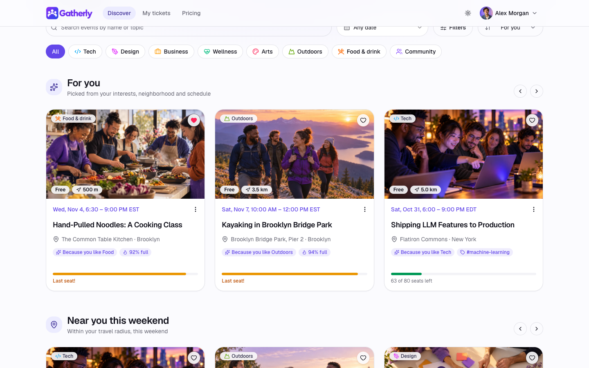

## Contents

- [Why it is built this way](#why-it-is-built-this-way)
- [Try the live demo](#try-the-live-demo)
- [Screenshots](#screenshots)
- [Run it locally](#run-it-locally)
- [Repository map](#repository-map)
- [Architecture at a glance](#architecture-at-a-glance)
- [Observability](#observability)
- [How the brief is covered](#how-the-brief-is-covered)
- [Assumptions, limitations and tradeoffs](#assumptions-limitations-and-tradeoffs)
- [Before production](#before-production)
- [Further documentation](#further-documentation)

## Why it is built this way

The guiding tradeoff: **ship a working product fast, but make every shortcut deliberate, visible and documented with its upgrade path.**

| Built now, because it is expensive to retrofit | Designed now, built later |
|---|---|
| Capacity that cannot overbook under concurrency, proven by a test | Sign-in with Google, Apple or Facebook, or an OIDC provider |
| Authorization in three layers (role, entitlement, ownership), enforced by the API | Paid tickets and payouts on Stripe Connect |
| A data model ready for paid tickets (seat holds, refunds, prices) | Waitlist, email notifications, mobile apps |
| Traces, logs, metrics and errors linked by one trace ID | Collector, tail sampling, alerting on SLOs |
| Ranking behind one interface, versioned, with every impression and outcome logged | A learned ranking model trained on those logs |

## Try the live demo

Two ways in:

- **Create an account** with email and password. A three-step onboarding asks what you are into, where you are in New York and when you are free; Discover then opens on **For you**.
- **Try a demo account**, no password: three personas on the sign-in page, switchable at any time from the avatar menu.

The demo holds about 200 members and 40 events across New York neighborhoods, with real registrations, saves and interaction history.

| Persona | Role and plan | What to try |
|---|---|---|
| **Olivia Bennett** (Organizer) | Member, Premium plan | Create an event and watch the live preview; edit capacity; open an event's attendee list and remove someone |
| **Alex Morgan** (Attendee) | Member, Free plan, onboarded | **For you** with reasons on every card; save an event, or mark one **Not interested**; reserve and cancel a seat; try **Host an event** to hit the Premium paywall |
| **Sam Patel** (Admin) | Administrator | Review platform stats; suspend a member or grant Premium; cancel any event; reset the demo data |

A five-minute tour:

1. **Create an account** and finish onboarding (pick three interests, a neighborhood, your free times). Discover opens on **For you**: each card says why it is there ("Because you like Tech", "1.8 km away", "Tuesday evening").
2. Search with a typo, such as `kayakng`; filter by distance or date; scroll to the end of the list.
3. Sign in as **Alex**, open any event and reserve a seat. The seat meter updates; the ticket appears under **My tickets**.
4. Cancel the reservation; the seat returns to the pool. Save an event with the heart, or hide one from the card menu.
5. Try **Host an event**. Alex is on the Free plan, so a paywall offers Premium (checkout answers "coming soon"; no real payments).
6. Switch to **Olivia**, create an event with a capacity of 2, then switch personas to fill it. The third attempt shows **Sold out**; the API refuses it with `EVENT_FULL`.
7. Switch to **Sam**. Suspend a background member, change a plan, or cancel an event. The demo personas themselves are protected so a public visitor cannot lock others out; **Reset demo data** restores everything.

The seed uses dates relative to today, and the server re-seeds when no upcoming events remain, so the demo stays fresh.

## Screenshots

| | |
|---|---|
| 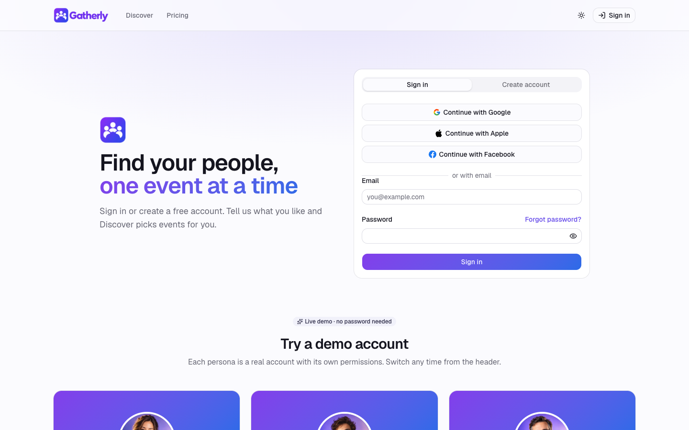 **Sign in:** email and password, or a demo account in one click | 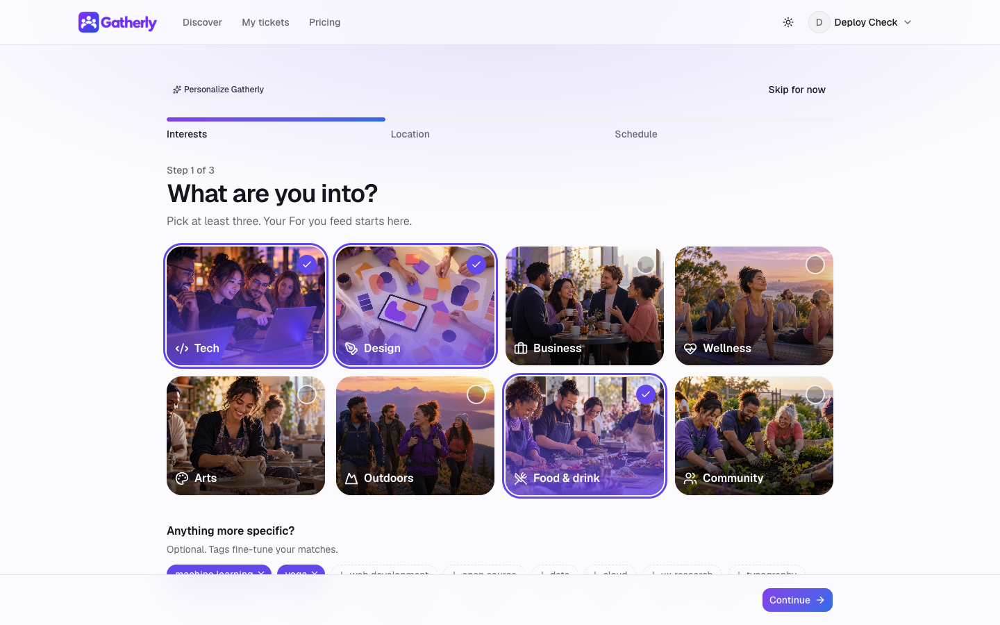 **Onboarding:** interests and tags, then location and schedule |
|  **For you:** ranked by interests, distance and schedule, with reasons | 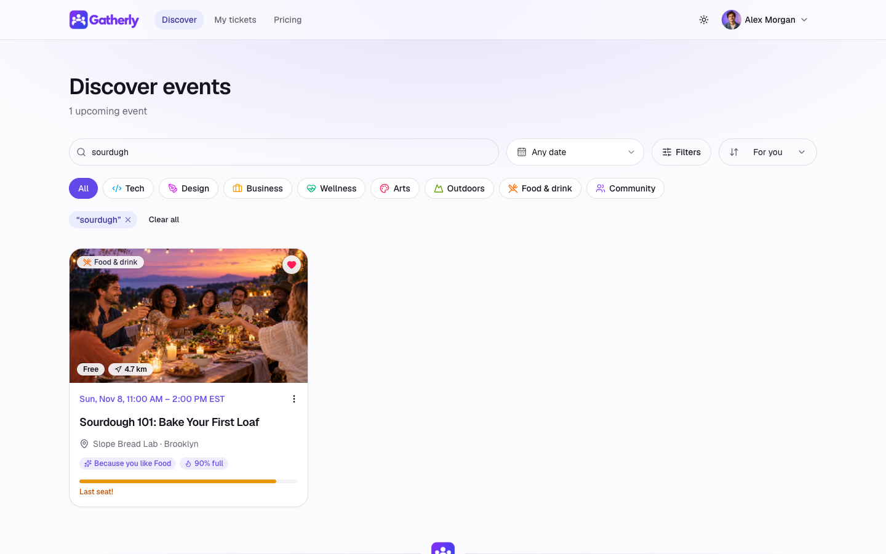 **Search:** full-text with typo tolerance ("sourdugh") |
| 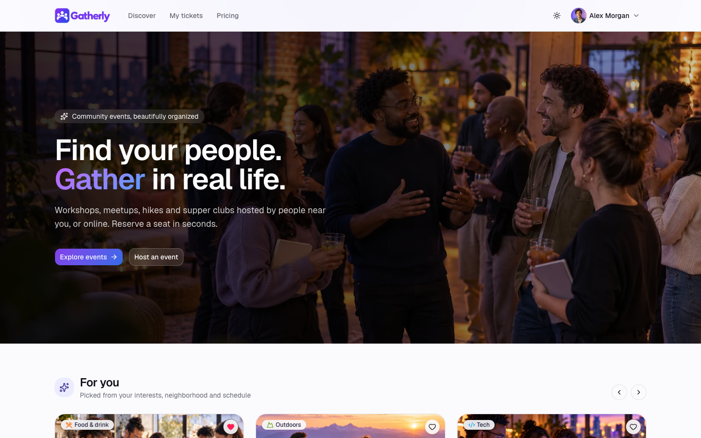 **Landing:** personal rails for signed-in members | 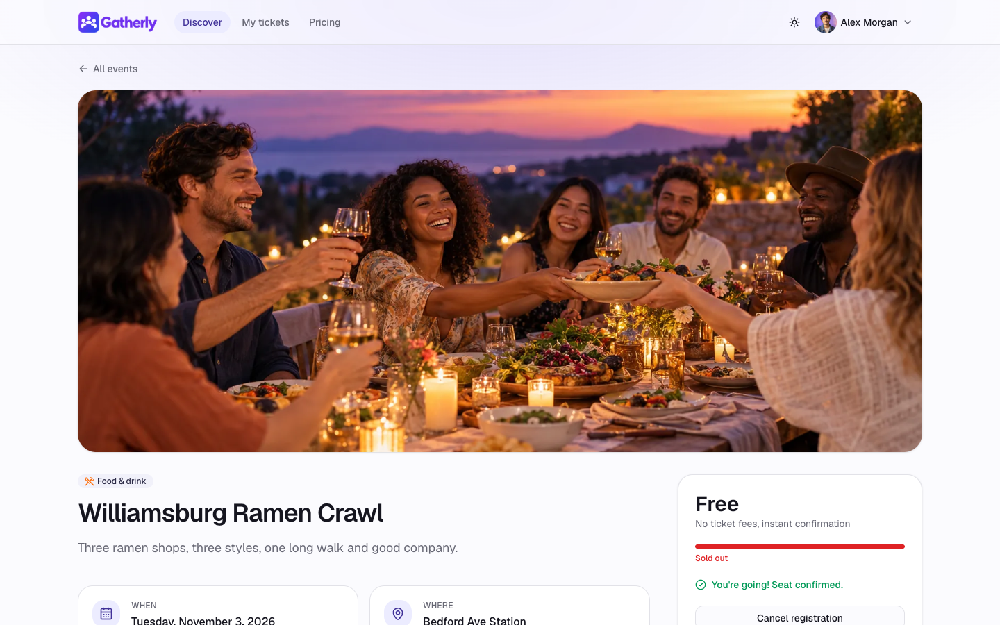 **Event detail:** seats meter and one-click reservation |
| 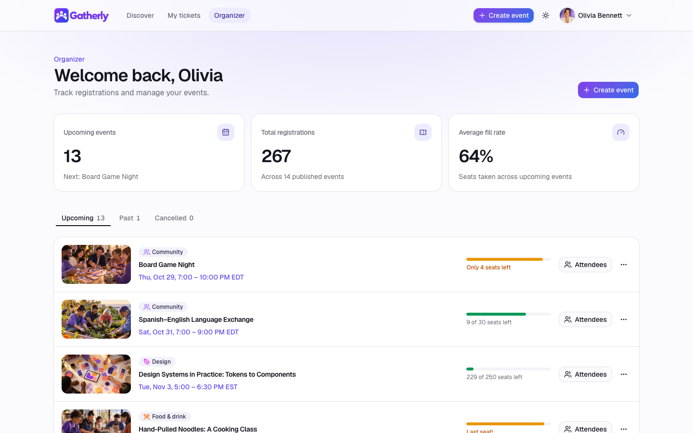 **Organizer dashboard:** fill rates and event management | 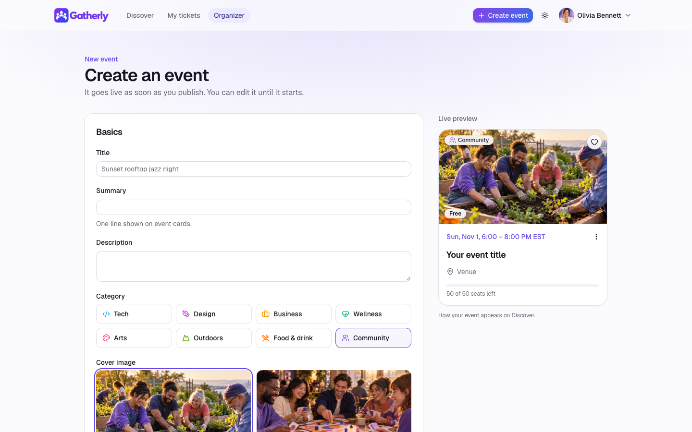 **Create event:** validated form with live preview |
| 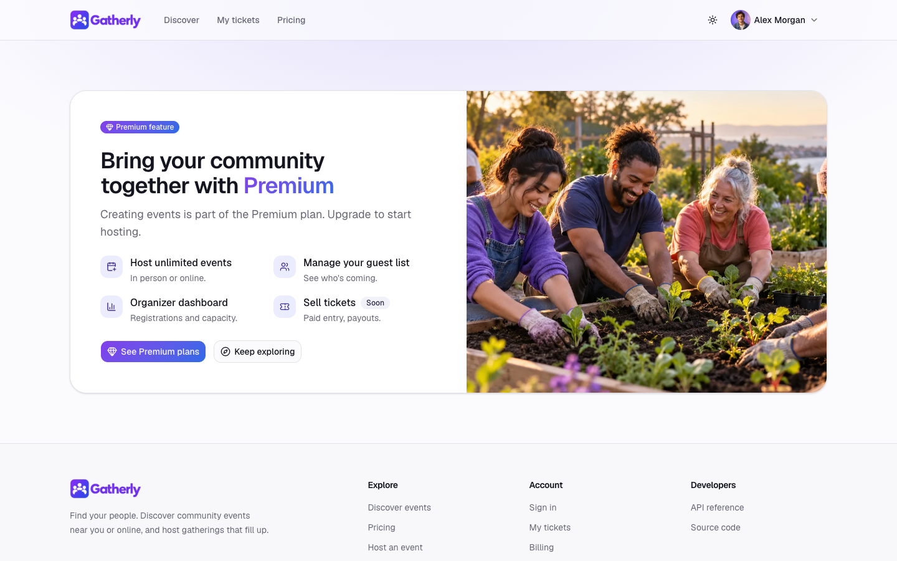 **Paywall:** a Free member trying to create an event | 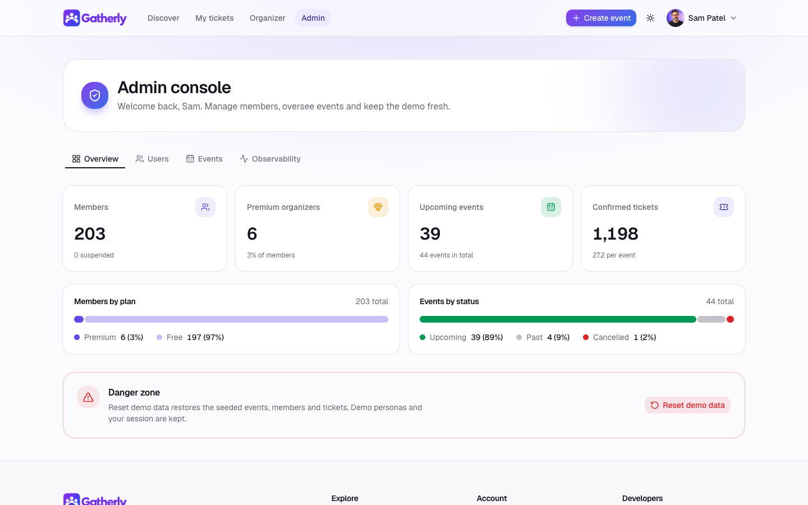 **Admin console:** platform stats, users, events, demo reset |

## Run it locally

Prerequisites: Node 22.12 or newer, pnpm 9 (`corepack enable` provides it), and Docker for Postgres.

```bash
cp .env.example .env
docker compose up -d db
pnpm install
pnpm db:migrate
pnpm dev
```

Open [localhost:5173](http://localhost:5173). The web dev server proxies `/api` to the API on port 3000. On first start the API creates the demo personas and seeds sample events.

| Task | Command | Notes |
|---|---|---|
| Tests | `pnpm test` | Runs against the `gatherly_test` database the Compose file creates |
| Lint, format, types | `pnpm lint` and `pnpm typecheck` | Same checks as CI |
| Production build | `pnpm build` | API bundle plus the web app; the API serves the web app when `NODE_ENV=production` |

Telemetry is off unless its variables are set; `.env.example` lists them. Nothing else is required to run locally.

## Repository map

| Path | What lives there |
|---|---|
| `apps/api` | Fastify REST API under `/api/v1`. `src/modules/*` holds one folder per area (auth, profile, events, discover, saves, interactions, registrations, organizer, admin, billing, health); `src/ranking` holds the ranker; `src/lib` holds guards, errors, rate limits and metrics; `src/db` holds the Drizzle schema, migrations runner and demo seed; `drizzle/` holds SQL migrations; `test/` holds the workflow and concurrency tests |
| `apps/web` | React single-page app (Vite, TanStack Query, React Router, Tailwind, shadcn/ui). `src/pages` has one file per route, `src/features` the page-specific components |
| `packages/shared` | Zod schemas, types, enums and error codes shared by API and web, so contracts cannot drift |
| `ops/grafana` | Grafana dashboard for request rate, errors, latency and business counters |
| `docs` | Architecture, API, monetization, observability, roadmap and decision records |
| `.github/workflows` | CI: lint, type check, tests against Postgres, build |
| `.replit` | Build and run configuration for the hosted demo |

## Architecture at a glance

One deployable unit: the Fastify process serves both the REST API and the built web app from the same origin, backed by Postgres, and sends telemetry to Grafana Cloud and errors to Sentry. iOS and Android clients would use the same versioned API.

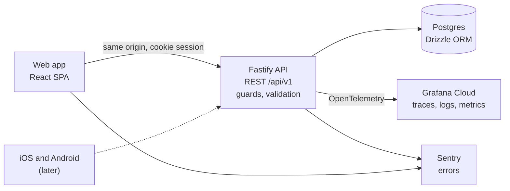

| Decision | Choice | Why | Price we pay | Record |
|---|---|---|---|---|
| Stack | TypeScript end to end: Fastify, Zod, Drizzle, Postgres, React | One language and one set of schemas for API, web and later mobile | Node is weaker for CPU-heavy work (we have none) | [ADR 0001](docs/adr/0001-stack.md) |
| Repository | pnpm workspace monorepo with a shared contracts package | API and clients change together | One pipeline builds everything | [ADR 0002](docs/adr/0002-monorepo.md) |
| Hosting | One Replit Autoscale deployment, free tier | Zero cost, live link, no CORS | Cold starts, one environment | [ADR 0003](docs/adr/0003-hosting.md) |
| Sign-in | Email and password (argon2id, rate-limited) plus demo personas; server-side sessions, HttpOnly cookie | Real accounts for personalization with no third party; reviewers still try every role in one click | No email verification or social sign-in yet | [ADR 0004](docs/adr/0004-demo-auth.md), [ADR 0008](docs/adr/0008-password-signup.md) |
| Authorization | Role, entitlement and ownership checks in API guards | Separates who you are, what you pay for and what you own | Three checks to reason about | [ADR 0005](docs/adr/0005-authorization-model.md) |
| Capacity | Atomic conditional update plus a partial unique index, one transaction | No overbooking, no extra infrastructure | One hot row per event caps peak throughput | [ADR 0006](docs/adr/0006-capacity-concurrency.md) |
| Telemetry | OpenTelemetry direct to Grafana Cloud; Sentry for errors | Mature signals on free tiers, no collector to run | No tail sampling | [ADR 0007](docs/adr/0007-telemetry.md) |
| Ranking | Rule-based scorer (`rules-v1`) behind a `Ranker` interface; reasons on every result; diversity rerank | Explainable and testable with no behavior data yet | Hand-tuned weights; a learned model needs data first | [ADR 0009](docs/adr/0009-rule-based-ranker.md) |
| Search | Postgres full-text search plus trigram matching (`pg_trgm`) | Relevance and typo tolerance with no search service | Single-city scale; a search engine later | [Architecture](docs/architecture.md#5-personalized-discovery) |
| Interaction data | Append-only `interactions` table: impressions and outcomes with surface, position and ranker version | Lets rankers be compared offline; privacy rules decided up front | Personal data to protect and expire | [ADR 0010](docs/adr/0010-interaction-data.md) |

The full picture, including the data model, request flow, permission matrix and scaling and security notes, is in [docs/architecture.md](docs/architecture.md).

## Observability

The live deployment sends traces, logs and metrics to Grafana Cloud and errors to Sentry. One trace ID follows a click from the browser through the API to every SQL query, log line and error, so a single ID answers "what happened, to whom, and why".

### See it live

No account needed: these views are public and read-only.

| Where | What you see |
|---|---|
| [Grafana dashboard](https://lankyholly1972.grafana.net/public-dashboards/9402737b590a4f538536e6057470aeba) | Request rate, errors and latency by API route, business counters, recent API logs and requests with trace IDs |
| Sentry: [browser error](https://khandev-s1.sentry.io/share/issue/5d7cc0bd2b5a4701aba7387a0b4b86d1/) and [API error](https://khandev-s1.sentry.io/share/issue/25e21197641d4401a8ebfddb8027efa0/) | Two errors from the same trace, with stack traces |
| Admin console, **Observability** tab (sign in as Sam) | Live version, database readiness and uptime, plus **Trigger test error**: sends a browser and an API error on one trace and shows the trace ID to look up in the dashboard |
| `x-trace-id` header on every API response | The ID to find any request in the dashboard or in Sentry |

Why public links rather than accounts, the privacy guardrails and the production path are in [docs/observability.md](docs/observability.md#see-it-live-no-account-needed).

| Signal | Where to look | What it shows |
|---|---|---|
| Browser pageload and API calls | Sentry trace view | Page timings, Web Vitals and the API request in one trace (the browser sends `traceparent`) |
| API spans | Grafana Tempo | Fastify route, hooks and each Postgres query |
| Logs | Grafana Loki | Structured request logs carrying `trace_id`, with email redacted |
| Metrics | Grafana dashboard from `ops/grafana/dashboard.json` | Request rate, errors and latency by route; registrations, cancellations, events created |
| Errors | Sentry `gatherly-api` and `gatherly-web` | Server errors (5xx only) and browser errors, tagged with release and trace |

| | |
|---|---|
| 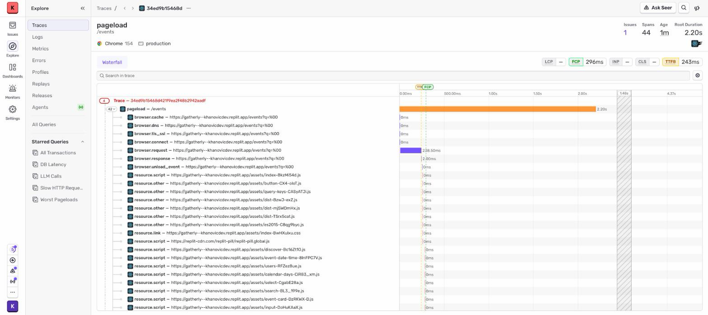 **Sentry:** browser pageload and the failing API call share one trace | 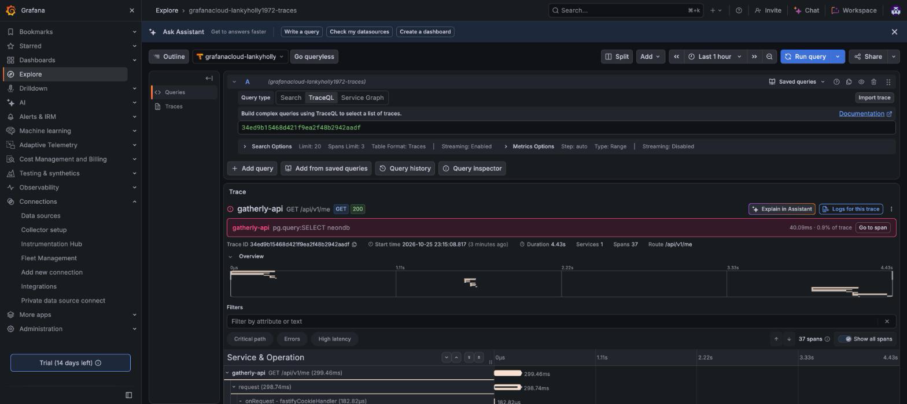 **Grafana Tempo:** the same trace ID with API and database spans |
| 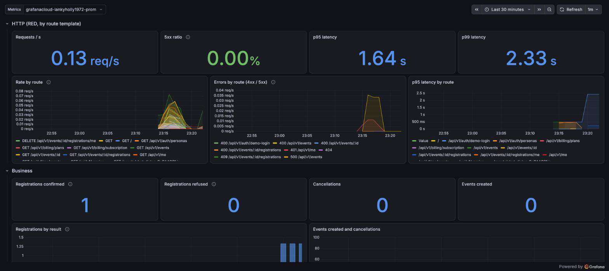 **Grafana dashboard:** HTTP rate, errors and latency by route, plus business counters | |

Details, including the trace flow and the plan beyond free tiers, are in [docs/observability.md](docs/observability.md).

## How the brief is covered

| Brief item | Where it lives |
|---|---|
| Organizer creates an event with date, time and capacity | `POST /api/v1/events`, gated by the `events:create` entitlement; times stored in UTC with the event's IANA time zone |
| Attendee registers | `POST /api/v1/events/:id/registrations` |
| No registrations once capacity is reached | Conditional update in one transaction; `409 EVENT_FULL` ([ADR 0006](docs/adr/0006-capacity-concurrency.md)) |
| Cancelling frees the seat | `DELETE /api/v1/events/:id/registrations/me`; re-registering afterwards is allowed |
| Validation and error handling | Shared Zod schemas; errors follow RFC 9457 problem details with stable codes ([docs/api.md](docs/api.md)) |
| Role-based authorization | Designed and implemented: roles, entitlements and ownership enforced by API guards; the UI only mirrors them ([permission matrix](docs/architecture.md#permission-matrix)) |
| Automated tests | `apps/api/test/registrations.test.ts`: the brief's workflow end to end, and 25 parallel registrations for 10 seats ending with exactly 10 confirmed |
| Architecture diagram and explanation | [docs/architecture.md](docs/architecture.md) |
| Beyond the brief: personalized discovery | Sign-up and onboarding, `GET /discover/home` rails, `GET /events?sort=for_you`, saves and hides, `POST /interactions` ([docs/api.md](docs/api.md)); the live API reference is at [/api/docs](https://gatherly--khanovicdev.replit.app/api/docs) |

## Assumptions, limitations and tradeoffs

### Assumptions

| Assumption | Effect |
|---|---|
| Organizing is a paid capability (Premium), attending is free | Organizer is a plan entitlement, not a separate account type; an admin can grant it |
| Events are free for now | Price fields exist, but the API rejects a price above zero with `PAID_TICKETS_UNAVAILABLE` |
| No waitlist in the MVP | A full event refuses new registrations; waitlist is on the roadmap |
| Registration closes when the event starts | Registering or cancelling afterwards returns `EVENT_STARTED` |
| Monetization (subscriptions plus a ticketing fee) is a hypothesis | Documented with options in [docs/monetization.md](docs/monetization.md), to validate with the business |

### Limitations

| Limitation | Why it is acceptable now | Upgrade path |
|---|---|---|
| Anyone can act as Admin through the demo personas | Reviewers need every role instantly; personas are protected and data can be reset | Remove the personas; admin roles only through an identity provider |
| Email sign-up has no verification or password reset; social buttons say "coming soon" | Enough to give each visitor their own preferences | OAuth providers and a hosted identity service ([ADR 0008](docs/adr/0008-password-signup.md)) |
| Rule-based ranking with hand-tuned weights; New York neighborhoods only, no geocoding | No behavior data to learn from yet; one demo city | A learned model evaluated offline on logged interactions; geocoded addresses |
| No email, waitlist, image upload or real payments | Not needed to prove the core workflow | [docs/roadmap.md](docs/roadmap.md) |
| One environment, no staging | Free hosting, CI on every change, local Postgres for development | Separate staging and production |
| Mobile apps are architecture only | The API is versioned and client-agnostic | Native or React Native clients on the same API |

### Hosting on the free Replit plan

| Effect | What it means for the demo |
|---|---|
| Scales to zero when idle | The first request after a quiet period has a cold start of a few seconds |
| Published link expires after 30 days | Renewed by republishing; the relative-date seed keeps content current |
| "Made with Replit" badge | Shown in the corner of the live site; it is part of the free plan |
| Single small instance | Fine for a demo; capacity safety comes from the database, not the instance count |

### Tradeoffs

| Chose | Over | Because |
|---|---|---|
| Database-level capacity enforcement | Queues or distributed locks | Correct under concurrency with no extra moving parts |
| One process serving API and web | Separate frontend hosting | One deployment, same origin, no CORS or cross-site cookies |
| Server-side sessions in Postgres | Stateless JWTs | Instant revocation (suspend, sign-out) with no extra store |
| Direct OTLP export to Grafana | Running a collector | Nothing extra to host; a collector comes with scale |

## Before production

What exists today and what must happen before real users and real money:

| Area | In place | Before production |
|---|---|---|
| Identity | Email and password with argon2id, rate-limited sign-in and sign-up, server-side sessions, HttpOnly cookies, suspended users blocked | Email verification, password reset, OAuth or OIDC sign-in, MFA for admins, account deletion |
| Authorization | Role, entitlement and ownership guards; protected demo accounts | Audit log of admin actions |
| Data | Migrations, constraints, partial unique index, race-safe capacity | Managed Postgres with backups and point-in-time recovery; restore drill |
| Security | Validated input, problem-details errors without internals, rate limits on authentication, no IPs or emails in logs | Rate limits on every write, security headers and CSP, dependency and secret scanning |
| Reliability | Health, readiness and version endpoints; graceful shutdown flushes telemetry | Minimum warm instances, staging environment, zero-downtime migrations |
| Observability | Traces, logs and metrics in Grafana; errors in Sentry; dashboard in `ops/grafana` | SLOs with alerts, synthetic checks, collector with tail sampling, log retention policy |
| Product | Core workflow, personalized discovery, organizer and admin tools, pricing and paywall | Email notifications through an outbox, waitlist, real subscriptions |
| Personal data | Interaction logging with a first-party anonymous ID, documented retention ([ADR 0010](docs/adr/0010-interaction-data.md)) | Consent banner where required, data export and deletion requests, enforced retention job |
| Delivery | CI with lint, types, tests against Postgres and build | Preview environments, release tagging, rollback runbook |

The full plan is in [docs/roadmap.md](docs/roadmap.md).

## Further documentation

| Document | Covers |
|---|---|
| [Architecture](docs/architecture.md) | System context, containers, request flow, data model, access control, scaling, security, integrations, mobile |
| [API](docs/api.md) | Endpoints, access rules and error codes; the live reference is at [/api/docs](https://gatherly--khanovicdev.replit.app/api/docs) |
| [Monetization](docs/monetization.md) | Plans, ticketing marketplace, seat holds, refunds, webhooks, tax |
| [Observability](docs/observability.md) | Signals, trace flow, dashboard, future plan |
| [Roadmap](docs/roadmap.md) | Now, next and later |
| [Decision records](docs/adr/README.md) | Short ADRs for each major choice |
