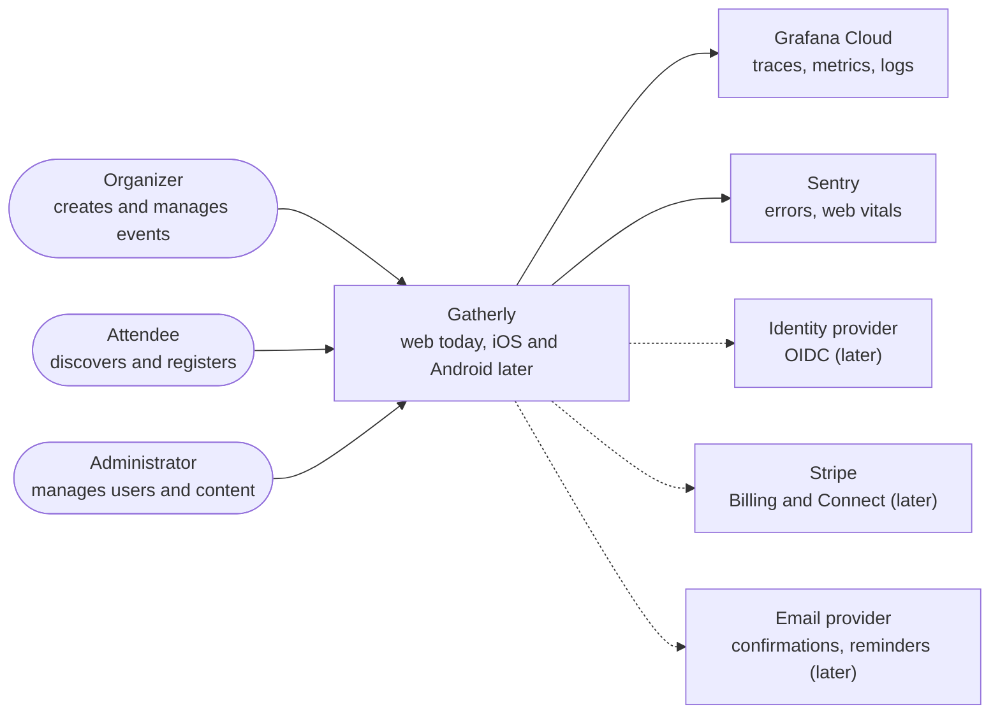
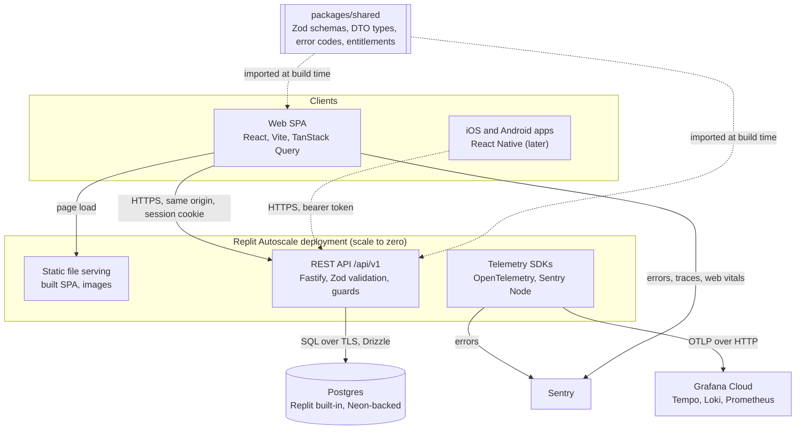
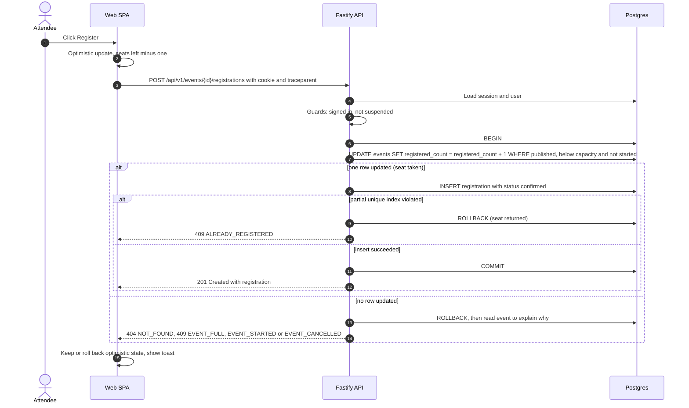
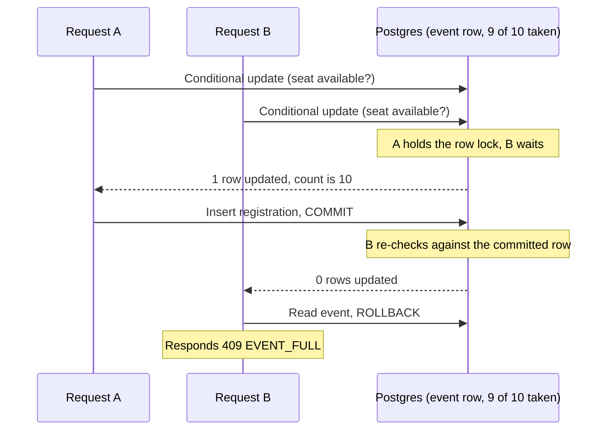
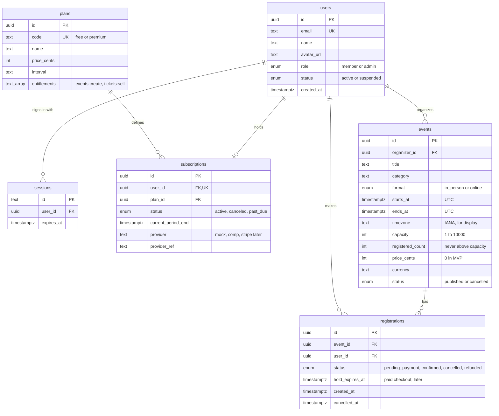
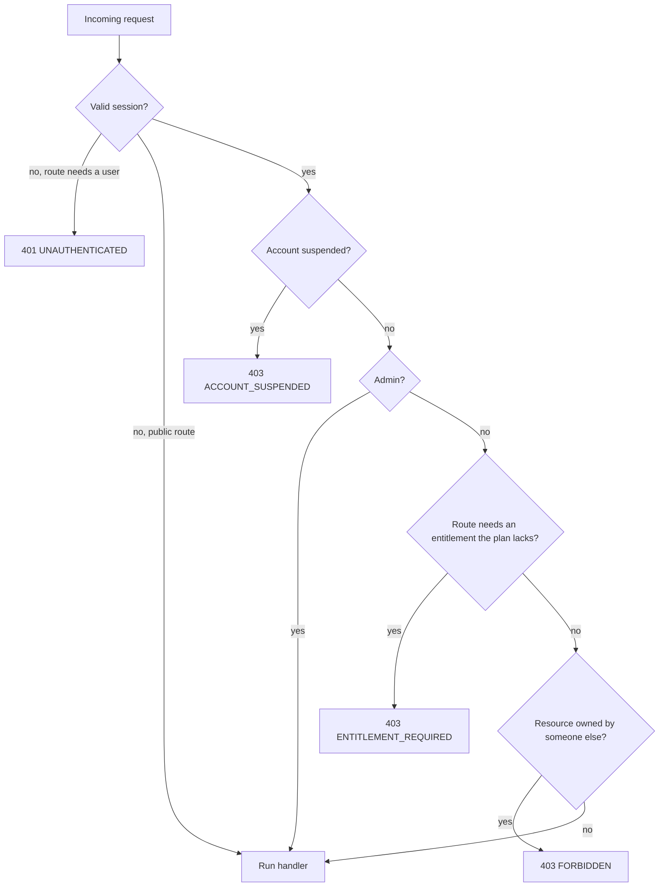

# Gatherly Architecture

Gatherly is a community events platform for three kinds of user: organizers who create events, attendees who register, and administrators who run the platform. This page explains how the system is built and why.

**Guiding tradeoff:** ship a working MVP fast, but make every shortcut deliberate, visible and documented with its upgrade path. Foundations that are expensive to retrofit (data integrity, authorization layers, telemetry, a payment-ready data model) are built or designed now. Everything else waits.

## Decisions at a glance

| Decision | Choice | Why | Tradeoff accepted | ADR |
|---|---|---|---|---|
| Language and stack | TypeScript end to end: Fastify, Zod, Drizzle, Postgres, React | One language and one set of schemas for API, web and later mobile | Node is not the fastest runtime for CPU-heavy work (we have none) | [0001](adr/0001-stack.md) |
| Repository | pnpm workspace monorepo: `apps/api`, `apps/web`, `packages/shared` | API and clients change together; contracts cannot drift | One CI pipeline builds everything | [0002](adr/0002-monorepo.md) |
| Hosting | One Replit Autoscale deployment (free tier); API serves the built SPA | Zero cost, live link, same origin (no CORS) | Cold starts, one environment, link renewal every 30 days | [0003](adr/0003-hosting.md) |
| Authentication | Demo persona sign-in, server-side sessions, HttpOnly cookie | Reviewers try every role in one click; no password handling | Not real identity; replaced by OIDC before production | [0004](adr/0004-demo-auth.md) |
| Authorization | Three layers: role, entitlement, ownership, enforced in API guards | Separates who you are, what you paid for, and what you own | Three checks to reason about instead of one role | [0005](adr/0005-authorization-model.md) |
| Capacity | Atomic conditional update plus partial unique index, one transaction | No overbooking under concurrency, no extra infrastructure | One hot row per event limits peak throughput on mega-events | [0006](adr/0006-capacity-concurrency.md) |
| Telemetry | OpenTelemetry direct to Grafana Cloud; errors to Sentry | Mature signals on free tiers, no collector to host | No tail sampling; exporter runs in the app process | [0007](adr/0007-telemetry.md) |

## 1. System context

Who uses Gatherly and which outside systems it depends on. Dashed lines are designed but not built in the MVP.

## 2. Containers

One deployable unit keeps the MVP cheap and simple. The boundaries inside it are drawn so each piece can be split out later without rewriting it.

| Container | Responsibility | Why this shape |
|---|---|---|
| Web SPA | All user screens; optimistic register and cancel; mirrors permissions for UX only | Served by the API from the same origin, so cookies work without CORS and there is one URL to share |
| REST API | Validation, authentication, authorization, domain rules, persistence | Stateless: sessions live in Postgres, so any instance can serve any request and Autoscale can add instances freely |
| `packages/shared` | Zod schemas, DTO types, error codes, enums, entitlement names | One definition drives API validation, web form validation, TypeScript types and the OpenAPI document |
| Postgres | System of record; enforces capacity and uniqueness with constraints | Transactions, partial unique indexes and check constraints are exactly the tools the capacity rule needs |
| Telemetry SDKs | Traces, logs and metrics to Grafana Cloud; errors to Sentry | Standard OpenTelemetry, so the backend can change by configuration. See [observability](observability.md) |

**The UI is never the security boundary.** Every rule the web app shows (paywall, disabled buttons, hidden admin pages) is enforced again by the API.

## 3. Request flow: register with capacity

Registration is the one write path where correctness matters most: two people must never get the last seat. The API does it in a single transaction with one conditional update, so Postgres, not application code, decides who wins.

**Why it cannot overbook.** The conditional update takes a row lock on the event. A second request for the same event waits on that lock; when the first commits, Postgres re-checks the second request's condition against the new row, sees no seat left, and updates nothing. A check constraint (`registered_count <= capacity`) is a second line of defense. An automated test fires 25 parallel registrations at a 10-seat event and asserts exactly 10 succeed.

**Cancel** runs the mirror image in one transaction: set the registration to `cancelled` (soft delete, keeps history) and decrement the counter. Re-registering after a cancel creates a new row, which the partial unique index allows because it only covers active statuses.

## 4. Data model

Events also carry presentation fields (summary, description, venue, city, online URL, cover image, timestamps), left out of the diagram for readability.

| Design choice | Why | Tradeoff |
|---|---|---|
| Denormalized `registered_count` on events | Capacity check is one indexed row update instead of a count over registrations under lock | Counter could drift from rows; prevented by updating both in one transaction, guarded by a check constraint |
| Partial unique index on `(event_id, user_id)` for `pending_payment` and `confirmed` only | Blocks double registration at the database, yet allows re-registering after a cancel | Uniqueness rule lives in the schema, so it must be documented (here) |
| Soft cancel (status plus `cancelled_at`) | Keeps history for organizers, analytics and later refunds | Queries must filter by status |
| Times stored in UTC plus the event's IANA timezone | Correct ordering and filtering; the event's local time is shown even across DST changes | Two values to keep consistent; validated on write |
| Registration status already includes `pending_payment` and `refunded` | Paid tickets later add states, not a migration of the core table | Two states unused in the MVP |
| Plans hold an entitlement list | Changing what a plan grants is data, not code | Entitlements must be named and versioned carefully (they live in `packages/shared`) |

Indexes: events by `(starts_at, status)` for discovery, events by `organizer_id` for dashboards, registrations by `user_id` for "my registrations", plus the partial unique index above.

### Domain rules

| Rule | Behavior | Error |
|---|---|---|
| Event time | Starts in the future; ends after it starts | `VALIDATION_FAILED` |
| Capacity | Whole number from 1 to 10,000; cannot drop below confirmed registrations | `CAPACITY_BELOW_REGISTERED` |
| Full event | Registration rejected; no waitlist yet (roadmap) | `EVENT_FULL` |
| Duplicate registration | Rejected while an active registration exists | `ALREADY_REGISTERED` |
| After start | No register or cancel once the event has started | `EVENT_STARTED` |
| Cancelled event | Stays visible with its registrations, marked cancelled; no new registrations | `EVENT_CANCELLED` |
| Organizer registering for own event | Allowed | none |
| Paid tickets | Price fields exist; any price above zero is rejected in the MVP | `PAID_TICKETS_UNAVAILABLE` |

## 5. Access control

Three independent layers answer three different questions. All are enforced in API guards; the web app reads the same data (`/me` returns role, plan and entitlements) only to shape the UI.

| Layer | Values | Answers | Example |
|---|---|---|---|
| Role | `member`, `admin` | Who are you to the platform? | Admins can manage users and any event |
| Entitlement | `events:create`, later `tickets:sell` | What does your plan grant? | Premium plan grants `events:create` |
| Ownership | `event.organizer_id = user.id` | Which resources do you control? | Only the organizer of an event (or an admin) can edit it |

**Why not an "organizer" role?** Being an organizer is a paid capability, not an identity. If it were a role, every upgrade, downgrade and lapsed payment would be a role change, and billing logic would leak into authorization. With entitlements, a lapsed Premium organizer keeps ownership of existing events (can still edit and cancel them) but loses `events:create`. Repackaging plans changes data, not guards.

### Permission matrix

Demo personas: **Alex** is an attendee (member, Free plan), **Olivia** an organizer (member, Premium plan), **Sam** an admin.

| Action | Anonymous | Attendee (Free) | Organizer (Premium) | Owner of the event | Admin |
|---|---|---|---|---|---|
| Browse and search events, view details | Yes | Yes | Yes | Yes | Yes |
| Register for or cancel own registration | 401 | Yes | Yes | Yes | Yes |
| View my registrations | 401 | Yes | Yes | Yes | Yes |
| Create an event | 401 | 403 `ENTITLEMENT_REQUIRED` (paywall) | Yes | Yes | Yes (override) |
| Edit or cancel an event | 401 | 403 | 403 unless owner | Yes | Yes |
| View attendees, remove an attendee | 401 | 403 | 403 unless owner | Yes | Yes |
| View plans and own subscription | Plans only | Yes | Yes | Yes | Yes |
| Start checkout | 401 | 501 `COMING_SOON` | 501 `COMING_SOON` | 501 `COMING_SOON` | 501 `COMING_SOON` |
| Manage users (suspend, role, plan), platform stats | 401 | 403 | 403 | 403 | Yes |
| Reset demo data | 401 | 403 | 403 | 403 | Yes |

A suspended user is blocked from everything except signing out (403 `ACCOUNT_SUSPENDED`). Because the demo has no passwords and anyone can act as Admin, the seeded personas are protected: they cannot be suspended, demoted or downgraded (409 `PROTECTED_DEMO_ACCOUNT`), the last admin cannot be demoted, and an admin-only **Reset demo data** action restores the seed.

## 6. MVP versus later

| Area | In the MVP | Later | Why it waits |
|---|---|---|---|
| Core workflow | Create event, register, capacity limit, cancel, race-safe | Waitlist with automatic promotion | Waitlist is a product decision (auto-promote or offer with expiry) worth validating first |
| Identity | Demo persona sign-in, server-side sessions | OIDC provider (Auth0, Clerk or Cognito), MFA for admins | Real identity is undifferentiated work; the session and guard layer stays the same |
| Authorization | Role, entitlement and ownership guards | Organizations with team roles (co-organizers); policy engine if rules multiply | No team use case yet; a policy engine is overhead for a dozen rules |
| Monetization | Pricing page, plan badge, paywall, admin plan grant, payment-ready schema | Stripe Billing subscriptions, paid tickets on Stripe Connect | Real money needs legal, tax and refund policy decisions first. See [monetization](monetization.md) |
| Notifications | None (in-app state only) | Email confirmations and reminders through an outbox; push on mobile | Needs a job runner and a provider; not needed to prove the workflow |
| Discovery | Text search, category and date filters, pagination | Full-text and geo search, recommendations | Postgres covers MVP volume |
| Media | Seeded images shipped with the app | Uploads to object storage behind a CDN, with resizing | Upload handling adds moderation and abuse surface |
| Clients | Responsive, mobile-first web | iOS and Android apps (section 10) | The API and shared schemas are already client-agnostic |
| Observability | Traces, logs, metrics, errors, dashboard, health endpoints | Collector with tail sampling, SLOs and alerts, real user monitoring | Free tiers and one service do not need a collector yet |
| Environments | One live deployment, local Docker Postgres, CI | Staging and production, backups with point-in-time recovery | Zero cost was a hard constraint |

## 7. Scaling considerations

The MVP is sized for a demo, but nothing in it blocks growth. Each pressure point has a known next step and a signal that says when to take it.

| Pressure point | MVP answer | Next step | Trigger |
|---|---|---|---|
| API throughput | Stateless instances, autoscaled | Container platform with minimum warm instances | Cold starts hurt real users |
| Database connections from many instances | Small per-instance pool | Connection pooler (PgBouncer or Neon pooler) | Connection errors during scale-out |
| Discovery reads | Indexed, paginated queries | HTTP caching of public lists at a CDN, then read replicas | Read latency or database CPU climbs |
| Hot event (thousands try to register at once) | Row lock held for one short transaction | Virtual waiting room or queue in front of registration; split seat inventory | Lock wait time on one event row |
| Background work | None | Job queue for email, reminders, hold expiry and webhooks, with a transactional outbox | First feature that sends email or takes payment |
| Search | `ILIKE` with filters | Postgres full-text or trigram, then a search engine; PostGIS for "near me" | Search latency or relevance complaints |
| Media | Static files in the app | Object storage plus CDN plus image resizing | User uploads |
| Telemetry volume | 100 percent sampling, direct export | Collector with tail sampling | Free-tier limits or cost |

## 8. Security considerations

| Concern | MVP | Before production |
|---|---|---|
| Authentication | Server-side sessions (revocable), HttpOnly, Secure, SameSite=Lax cookie | OIDC provider, MFA for admins, session rotation on privilege change |
| Authorization | Every rule enforced in API guards; UI only mirrors | Audit log of admin actions; organization-scoped roles |
| Input validation | Zod schemas at the API boundary; Drizzle parameterized SQL | Same, plus payload size limits per route |
| Cross-site requests | Same-origin SPA, SameSite=Lax cookie, JSON-only API | CSRF token if any cross-site form or embed appears |
| Secrets | Replit Secrets and local `.env` (never committed); config validated at startup | Secret manager with rotation |
| Personal data | Email redacted from logs; minimal fields stored | Data export and deletion on request; retention policy |
| Abuse | Protected demo personas, demo reset | Rate limits on sign-in and registration, bot protection on high-demand events |
| Supply chain | Lockfile, CI on every pull request | Dependency and secret scanning, security headers |

## 9. Third-party integrations

Every external service sits behind a small interface owned by Gatherly, so it can be mocked in tests and replaced without touching domain code. The MVP already does this for payments: checkout goes through a payment provider interface whose mock returns `COMING_SOON`.

| Integration | Purpose | Status | Key consideration |
|---|---|---|---|
| Grafana Cloud | Traces, logs, metrics, dashboard | Built | Keep metric labels low-cardinality on the free tier |
| Sentry | Errors and performance, web and API, linked to traces | Built | Report server errors, not expected domain rejections |
| Identity provider (OIDC) | Real sign-in, social login, MFA | Designed | Map provider identity to a Gatherly user, then reuse the existing session |
| Stripe Billing | Organizer subscriptions | Designed | Webhooks drive entitlements; never trust the client |
| Stripe Connect | Paid tickets and organizer payouts | Designed | Verified, idempotent webhooks and a ledger. See [monetization](monetization.md) |
| Email provider | Confirmations, reminders, cancellations | Later | Sent from an outbox so a provider outage never fails a registration |
| Calendar | Add-to-calendar files | Later | Generate from UTC time plus the event timezone |
| Maps and geocoding | Venue maps, "near me" search | Later | Cache results; respect provider terms |

Inbound webhooks (Stripe, email events) follow one pattern: verify the signature, store the event by its provider ID to drop duplicates, process it in a transaction, respond quickly.

## 10. Mobile approach

The brief targets web, iOS and Android. The MVP ships a responsive, mobile-first web app; the architecture is ready for native apps without backend changes.

| Decision | Choice | Why | Tradeoff |
|---|---|---|---|
| Framework | React Native with Expo | Reuses TypeScript, `packages/shared` schemas and TanStack Query patterns; one team ships both platforms | Platform-specific features (wallet passes, widgets) need native modules |
| API | The same versioned REST API (`/api/v1`), with typed clients generated from its OpenAPI document | One backend for all clients; versioning protects installed apps that update slowly | Breaking changes need a new version and a deprecation window |
| Authentication | OIDC with PKCE in the system browser; the API accepts a bearer token alongside the web cookie | Cookies are awkward in native apps; PKCE is the standard for public clients | Two credential types to validate (same session table behind both) |
| Offline | Cache "my registrations" and ticket details on the device | Attendees open tickets at venues with poor signal | Cached data can be stale; show last-synced time |
| Notifications | Push through Expo (APNs and FCM), fed by the same outbox as email | Reminders and cancellations reach people quickly | Push tokens to manage per device |
| Interim | Mobile-first responsive web, installable as a PWA | Covers phones now at no extra cost | No app store presence |

## Further reading

[API reference](api.md) · [Monetization design](monetization.md) · [Observability](observability.md) · [Roadmap](roadmap.md) · [Architecture decision records](adr/README.md)
