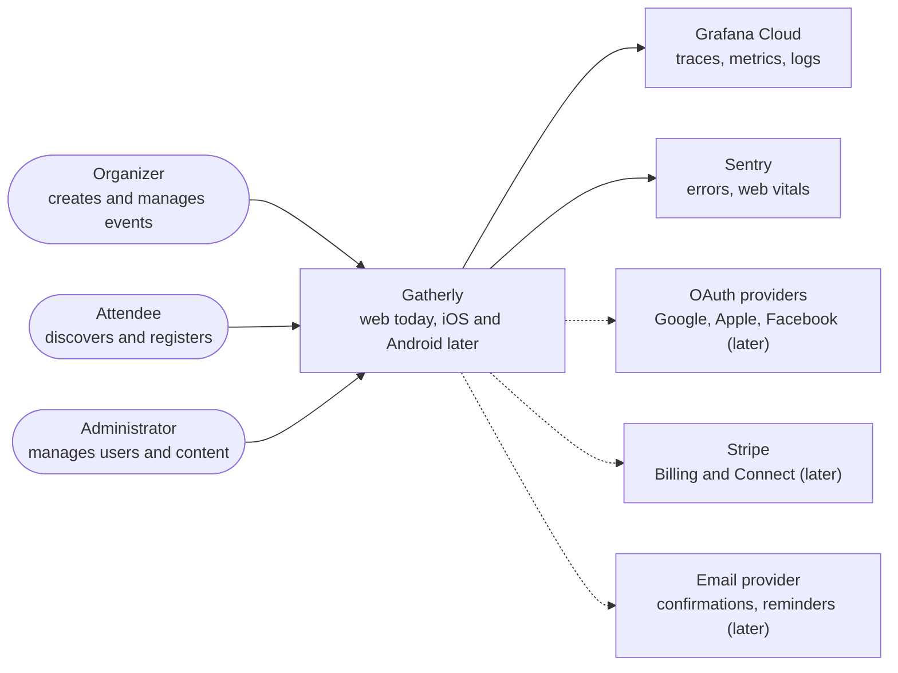
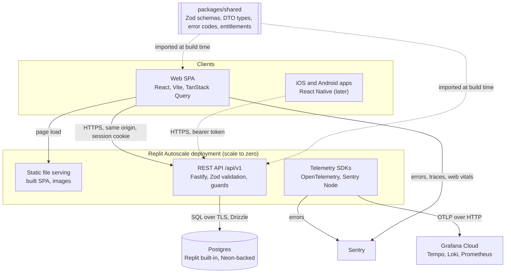
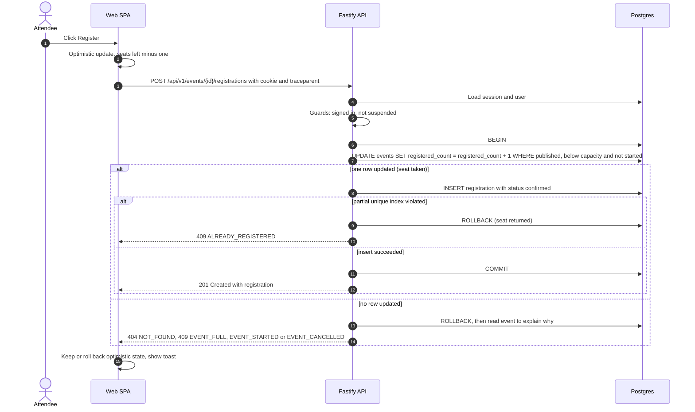
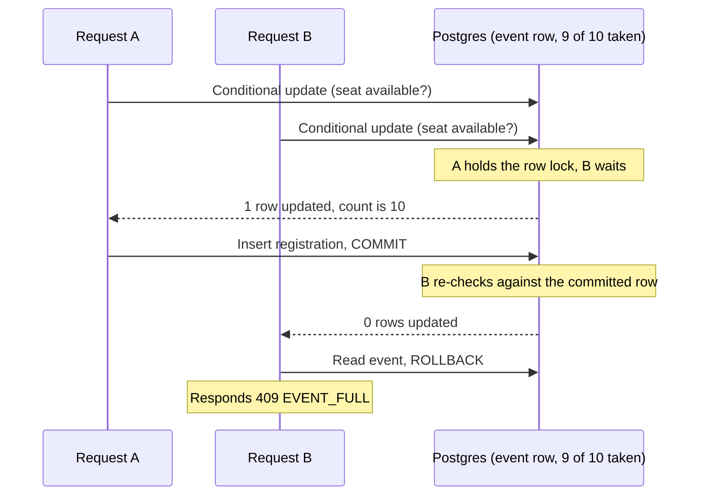
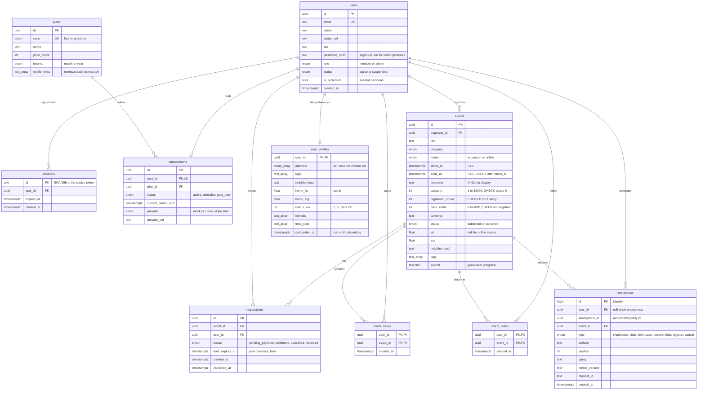
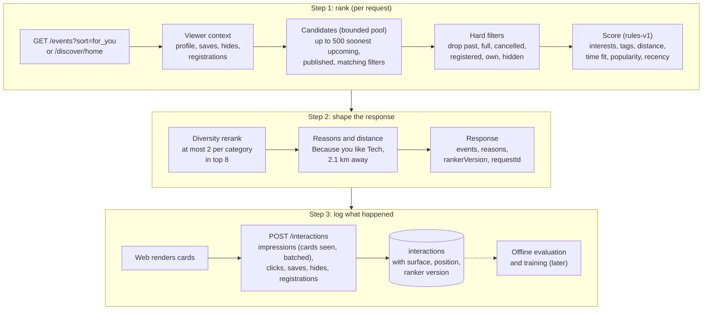
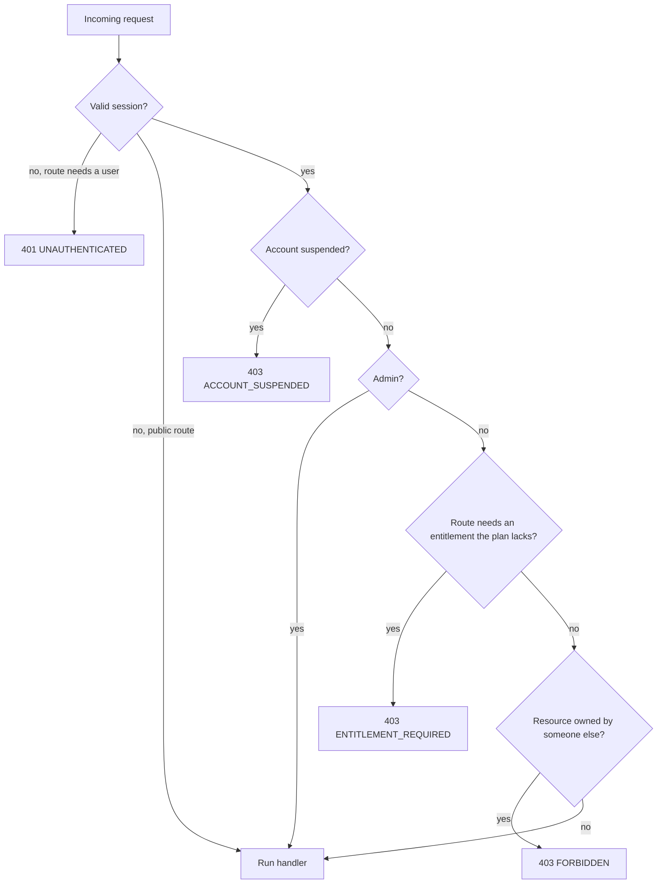

# Gatherly Architecture

Gatherly is a community events platform for three kinds of user: organizers who create events, attendees who register, and administrators who run the platform. This page explains how the system is built and why.

**Guiding tradeoff:** ship a working MVP fast, but make every shortcut deliberate, visible and documented with its upgrade path. Foundations that are expensive to retrofit (data integrity, authorization layers, telemetry, a payment-ready data model, interaction logging for personalization) are built or designed now. Everything else waits.

## Brief at a glance

Every question in the brief, the short answer, and where the long answer lives.

| Brief asks | Short answer | Details |
|---|---|---|
| Diagram and brief explanation | One deployable unit: a Fastify API that also serves the React app, backed by Postgres, exporting telemetry | [Containers](#2-containers), [system context](#1-system-context) |
| How backend, database and clients interact | Web calls `/api/v1` from the same origin with a session cookie; mobile would call the same versioned API with a bearer token; Postgres is the only state | [Containers](#2-containers), [mobile](#11-mobile-approach) |
| Core entities and relationships | Users, events, registrations, plans and subscriptions; profiles, saves, hides and interactions for discovery | [Data model](#4-data-model) |
| How user types access the system | Role (member or admin), plan entitlement (`events:create` makes an organizer) and ownership, all enforced by API guards | [Access control](#6-access-control), [permission matrix](#permission-matrix) |
| Technology choices for an MVP | TypeScript end to end with one shared schema package; Postgres does capacity, search and sessions, so no extra infrastructure | [Decisions](#decisions-at-a-glance), [ADRs](adr/README.md) |
| MVP versus later | Core workflow, authorization, telemetry and a payment-ready schema now; payments, notifications, native apps and learned ranking later | [MVP versus later](#7-mvp-versus-later), [roadmap](roadmap.md) |
| Scaling, security, third parties | Each pressure point has a next step and a trigger; the UI is never the security boundary; every vendor sits behind a small interface | Sections [8](#8-scaling-considerations), [9](#9-security-considerations), [10](#10-third-party-integrations) |
| Create event, register, refuse when full, cancel | REST endpoints; one conditional update in one transaction decides who gets the last seat | [Request flow](#3-request-flow-register-with-capacity), [API](api.md) |
| Persistence, validation, error handling | Postgres with check constraints and a partial unique index; Zod at the boundary; RFC 9457 problem details with stable codes | [Domain rules](#domain-rules), [error codes](api.md#error-codes) |
| Describe role-based authorization | Designed and implemented in guards, not only described | [Access control](#6-access-control), [ADR 0005](adr/0005-authorization-model.md) |
| At least one automated test | Integration tests against Postgres: the brief's workflow through the API, an error-path table, and concurrent registrations for the last seats | `apps/api/test` |
| Short README: run, decisions, assumptions, before production | [README](../README.md) | [Roadmap](roadmap.md) for the ordered plan |

## Decisions at a glance

| Decision | Choice | Why | Tradeoff accepted | ADR |
|---|---|---|---|---|
| Language and stack | TypeScript end to end: Fastify, Zod, Drizzle, Postgres, React | One language and one set of schemas for API, web and later mobile | Node is not the fastest runtime for CPU-heavy work (we have none) | [0001](adr/0001-stack.md) |
| Repository | pnpm workspace monorepo: `apps/api`, `apps/web`, `packages/shared` | API and clients change together; contracts cannot drift | One CI pipeline builds everything | [0002](adr/0002-monorepo.md) |
| Hosting | One Replit Autoscale deployment (free tier); API serves the built SPA | Zero cost, live link, same origin (no CORS) | Cold starts, one environment, link renewal every 30 days | [0003](adr/0003-hosting.md) |
| Authentication | Email and password sign-up (argon2id); server-side sessions, HttpOnly cookie; one-click demo personas only when `DEMO_MODE` is on | Real accounts that remember preferences, with no third party or paid developer program | We own password storage; no email verification or reset yet; OAuth later | [0008](adr/0008-password-signup.md) (sessions from [0004](adr/0004-demo-auth.md)) |
| Authorization | Three layers: role, entitlement, ownership, enforced in API guards | Separates who you are, what you paid for, and what you own | Three checks to reason about instead of one role | [0005](adr/0005-authorization-model.md) |
| Capacity | Atomic conditional update plus partial unique index, one transaction | No overbooking under concurrency, no extra infrastructure | One hot row per event limits peak throughput on mega-events | [0006](adr/0006-capacity-concurrency.md) |
| Telemetry | OpenTelemetry direct to Grafana Cloud; errors to Sentry | Mature signals on free tiers, no collector to host | No tail sampling; exporter runs in the app process | [0007](adr/0007-telemetry.md) |
| Ranking | Rule-based "For you" ranker behind a `Ranker` interface, versioned, with reasons per result | Works with no behavior data, explainable, testable; a model can replace it without contract changes | Hand-tuned weights until real data exists | [0009](adr/0009-rule-based-ranker.md) |
| Interaction data | First-party, append-only interactions table (impressions to registrations) with ranker version and position | Lets us evaluate rankers offline and train models later | Personal data to protect; retention and consent rules apply | [0010](adr/0010-interaction-data.md) |

## 1. System context

Who uses Gatherly and which outside systems it depends on. Dashed lines are designed but not built in the MVP.

## 2. Containers

One deployable unit keeps the MVP cheap and simple. The boundaries inside it are drawn so each piece can be split out later without rewriting it.

| Container | Responsibility | Why this shape |
|---|---|---|
| Web SPA | All user screens; optimistic register and cancel; mirrors permissions for UX only | Served by the API from the same origin, so cookies work without CORS and there is one URL to share |
| REST API | Validation, authentication, authorization, domain rules, persistence | Stateless: sessions live in Postgres, so any instance can serve any request and Autoscale can add instances freely |
| `packages/shared` | Zod schemas, DTO types, error codes, enums, entitlement names | One definition drives API validation, web form validation, TypeScript types and the OpenAPI document |
| Postgres | System of record; enforces capacity and uniqueness with constraints | Transactions, partial unique indexes and check constraints are exactly the tools the capacity rule needs |
| Telemetry SDKs | Traces, logs and metrics to Grafana Cloud; errors to Sentry | Standard OpenTelemetry, so the backend can change by configuration. See [observability](observability.md) |

**The UI is never the security boundary.** Every rule the web app shows (paywall, disabled buttons, hidden admin pages) is enforced again by the API.

## 3. Request flow: register with capacity

Registration is the one write path where correctness matters most: two people must never get the last seat. The API does it in a single transaction with one conditional update, so Postgres, not application code, decides who wins.

**Why it cannot overbook.** The conditional update takes a row lock on the event. A second request for the same event waits on that lock; when the first commits, Postgres re-checks the second request's condition against the new row, sees no seat left, and updates nothing. A check constraint (`registered_count <= capacity`) is a second line of defense. An automated test fires 25 parallel registrations at a 10-seat event and asserts exactly 10 succeed.

**Cancel** runs the mirror image in one transaction: set the registration to `cancelled` (soft delete, keeps history) and decrement the counter. Register and cancel lock the event row before the registration row, always in that order, so a register and a cancel racing on the same event cannot deadlock. Re-registering after a cancel creates a new row, which the partial unique index allows because it only covers active statuses.

## 4. Data model

Events also carry presentation fields (summary, description, venue, city, online URL, cover image, timestamps), left out of the diagram for readability.

| Design choice | Why | Tradeoff |
|---|---|---|
| Denormalized `registered_count` on events | Capacity check is one indexed row update instead of a count over registrations under lock | Counter could drift from rows; prevented by updating both in one transaction, guarded by a check constraint |
| Partial unique index on `(event_id, user_id)` for `pending_payment` and `confirmed` only | Blocks double registration at the database, yet allows re-registering after a cancel | Uniqueness rule lives in the schema, so it must be documented (here) |
| Soft cancel (status plus `cancelled_at`) | Keeps history for organizers, analytics and later refunds | Queries must filter by status |
| Times stored in UTC plus the event's IANA timezone | Correct ordering and filtering; the event's local time is shown even across DST changes | Two values to keep consistent; validated on write |
| Registration status already includes `pending_payment` and `refunded` | Paid tickets later add states, not a migration of the core table | Two states unused in the MVP |
| Plans hold an entitlement list | Changing what a plan grants is data, not code | Entitlements must be named and versioned carefully (they live in `packages/shared`) |
| Preferences in `user_profiles`, apart from `users` | Identity stays small; preferences are private and change often | One more join for ranking |
| Saves and hides as their own tables, keyed by user and event | Current state is one indexed lookup; idempotent put and delete | Their history lives in `interactions` instead |
| Generated, weighted search column | Title weighs most, then tags, summary, description; always in sync with the row | Write cost on every event update |
| Fixed neighborhood list with coordinates instead of a geocoding API | Zero cost, no third party, predictable demo (New York) | Only works for listed neighborhoods until geocoding arrives |

Indexes: events by `(starts_at, status)` for discovery, events by `organizer_id` for dashboards, registrations by `user_id` for "my registrations", plus the partial unique index above. Search uses a GIN index on the weighted search column and a trigram index on titles for typo tolerance. Interactions are indexed by user and time, and by event.

### Domain rules

| Rule | Behavior | Error |
|---|---|---|
| Event time | Starts in the future and within two years; ends after it starts and at most seven days later. The database also checks that the end follows the start | `VALIDATION_FAILED` |
| Capacity | Whole number from 1 to 10,000 (the database checks it is above zero); cannot drop below confirmed registrations | `CAPACITY_BELOW_REGISTERED` |
| Editing | No edits once the event has started or been cancelled | `EVENT_STARTED`, `EVENT_CANCELLED` |
| Full event | Registration rejected; no waitlist yet (roadmap) | `EVENT_FULL` |
| Duplicate registration | Rejected while an active registration exists | `ALREADY_REGISTERED` |
| After start | No register or cancel once the event has started | `EVENT_STARTED` |
| Cancelling an event | Owner or admin, before it starts; its active registrations are cancelled in the same transaction and stay as history; the event stays visible, marked cancelled | `EVENT_STARTED`, then `EVENT_CANCELLED` for any later register or edit |
| Organizer registering for own event | Allowed | none |
| Paid tickets | Price fields exist (the database refuses negative prices); any price above zero is rejected in the MVP | `PAID_TICKETS_UNAVAILABLE` |

## 5. Personalized discovery

Discover ranks events for each person, explains why, and learns from what happens next. Rules now, models later; see [ADR 0009](adr/0009-rule-based-ranker.md) and the personalization stages in the [roadmap](roadmap.md).

| Piece | Design | Why |
|---|---|---|
| Profile and onboarding | Three skippable steps after sign-up: interests, neighborhood and travel radius, formats and time slots | Gives the ranker useful signals on day one instead of waiting for behavior |
| Location | Fixed list of New York neighborhoods with coordinates, or a location the user chooses to share; online events have none | No geocoding service, no background tracking |
| Search | Postgres full-text search with weights, trigram matching for typos, filters for category, tags, format, distance, dates and free events | Good relevance without a search cluster |
| Sort options | For you (default when signed in and onboarded), soonest, nearest, popular | Personalization never hides the plain orders people expect |
| Candidate pool | Soonest, nearest and popular are sorted and paged in SQL over every match, with an exact total. For you and the home rails score a bounded pool of the 500 soonest matches in memory, so an event further out than that pool never ranks; the list then reports `totalCapped` and Discover points to the other sorts | Simple, explainable scoring at one-city scale; candidate retrieval moves into the database (PostGIS, search engine, embeddings) before the catalog outgrows the pool |
| Home rails | "For you", "Near you this weekend", "Popular now"; anonymous visitors get popular and, if shared, nearby | One request fills the landing and Discover pages |
| Save and not interested | Heart and hide on every card; hidden events never come back; saved events on their own page (`/me/saved`) | Explicit feedback is the strongest signal we can get |
| Real numbers | Seat counts, attendee lists and popularity come from real rows, including the seeded community | What the ranker sees is what users see |
| Logging | Every ranked response has a ranker version and request ID; impressions and outcomes are logged against them | Rankers can be compared offline and swapped safely; see [ADR 0010](adr/0010-interaction-data.md) |

## 6. Access control

Three independent layers answer three different questions. All are enforced in API guards; the web app reads the same data (`/me` returns role, plan and entitlements) only to shape the UI.

| Layer | Values | Answers | Example |
|---|---|---|---|
| Role | `member`, `admin` | Who are you to the platform? | Admins can manage users and any event |
| Entitlement | `events:create`, later `tickets:sell` | What does your plan grant? | Premium plan grants `events:create` |
| Ownership | `event.organizer_id = user.id` | Which resources do you control? | Only the organizer of an event (or an admin) can edit it |

**Why not an "organizer" role?** Being an organizer is a paid capability, not an identity. If it were a role, every upgrade, downgrade and lapsed payment would be a role change, and billing logic would leak into authorization. With entitlements, a lapsed Premium organizer keeps ownership of existing events (can still edit and cancel them) but loses `events:create`. Repackaging plans changes data, not guards.

### Permission matrix

Demo personas: **Alex** is an attendee (member, Free plan), **Olivia** an organizer (member, Premium plan), **Sam** an admin.

| Action | Anonymous | Attendee (Free) | Organizer (Premium) | Owner of the event | Admin |
|---|---|---|---|---|---|
| Browse and search events, view details | Yes | Yes | Yes | Yes | Yes |
| Register for or cancel own registration | 401 | Yes | Yes | Yes | Yes |
| View my registrations | 401 | Yes | Yes | Yes | Yes |
| Sign up or sign in with email and password | Yes | n/a | n/a | n/a | n/a |
| Edit own profile and preferences; save or hide events | 401 | Yes | Yes | Yes | Yes |
| View a public profile; get the Discover home rails | Yes | Yes | Yes | Yes | Yes |
| Record interactions (impressions, clicks) | Yes, under an anonymous ID | Yes | Yes | Yes | Yes |
| Create an event | 401 | 403 `ENTITLEMENT_REQUIRED` (paywall) | Yes | Yes | Yes (override) |
| Edit or cancel an event | 401 | 403 | 403 unless owner | Yes | Yes |
| View attendees, remove an attendee | 401 | 403 | 403 unless owner | Yes | Yes |
| View plans and own subscription | Plans only | Yes | Yes | Yes | Yes |
| Start checkout | 401 | 501 `COMING_SOON` | 501 `COMING_SOON` | 501 `COMING_SOON` | 501 `COMING_SOON` |
| Manage users (suspend, role, plan), platform stats | 401 | 403 | 403 | 403 | Yes |
| Reset demo data (demo mode only) | 401 | 403 | 403 | 403 | Yes |

A suspended user gets 403 `ACCOUNT_SUSPENDED` on every route that needs a session; public routes (browsing, logout, interaction logging) still answer, as they would for a visitor. The last active admin cannot be demoted or suspended (403 `FORBIDDEN`).

**Demo mode.** With `DEMO_MODE=true` (the hosted demo and local Compose), anyone can sign in as a persona without a password, including the admin persona. Guardrails follow from that: the personas cannot be suspended, demoted or downgraded (409 `PROTECTED_DEMO_ACCOUNT`); admins cannot change real accounts (people who signed up on the demo), and real emails are masked (`j***@example.com`) and unsearchable in the admin user list and attendee lists; sign-up refuses the reserved `@gatherly.demo` domain; **Reset demo data** deletes every event hosted by a demo account (personas included) and every non-persona `@gatherly.demo` member, resets the personas, recounts seats on events real accounts host, and reseeds. Real accounts and their sessions stay; their registrations, saves and hides on demo events go with those events. With `DEMO_MODE` off (the default), demo sign-in and demo reset return 404, the persona list is empty, and the server never seeds or deletes data on start.

## 7. MVP versus later

| Area | In the MVP | Later | Why it waits |
|---|---|---|---|
| Core workflow | Create event, register, capacity limit, cancel, race-safe | Waitlist with automatic promotion | Waitlist is a product decision (auto-promote or offer with expiry) worth validating first |
| Identity | Email and password sign-up and sign-in, demo personas, server-side sessions | OAuth (Google, Apple, Facebook), email verification, password reset, MFA for admins | Providers need registrations and a stable domain; the session and guard layer stays the same |
| Authorization | Role, entitlement and ownership guards | Organizations with team roles (co-organizers); policy engine if rules multiply | No team use case yet; a policy engine is overhead for a dozen rules |
| Monetization | Pricing page, plan badge, paywall, admin plan grant, payment-ready schema | Stripe Billing subscriptions, paid tickets on Stripe Connect | Real money needs legal, tax and refund policy decisions first. See [monetization](monetization.md) |
| Notifications | None (in-app state only) | Email confirmations and reminders through an outbox; push on mobile | Needs a job runner and a provider; not needed to prove the workflow |
| Discovery | Weighted full-text and typo-tolerant search, distance filter, rule-based "For you" ranking with reasons, saves and hides | Learning-to-rank, embeddings, social signals, experiments (roadmap stages) | No behavior data to learn from yet; rules are explainable |
| Media | Seeded images shipped with the app | Uploads to object storage behind a CDN, with resizing | Upload handling adds moderation and abuse surface |
| Clients | Responsive, mobile-first web | iOS and Android apps (section 11) | The API and shared schemas are already client-agnostic |
| Observability | Traces, logs, metrics, errors, dashboard, health endpoints | Collector with tail sampling, SLOs and alerts, real user monitoring | Free tiers and one service do not need a collector yet |
| Environments | One live deployment, local Docker Postgres, CI | Staging and production, backups with point-in-time recovery ([operations](operations.md#1-operations)) | Zero cost was a hard constraint |

## 8. Scaling considerations

The MVP is sized for a demo, but nothing in it blocks growth. Each pressure point has a known next step and a signal that says when to take it.

| Pressure point | MVP answer | Next step | Trigger |
|---|---|---|---|
| API throughput | Stateless instances, autoscaled | Container platform with minimum warm instances | Cold starts hurt real users |
| Database connections from many instances | Small per-instance pool | Connection pooler (PgBouncer or Neon pooler) | Connection errors during scale-out |
| Discovery reads | Indexed SQL filters, paginated; For you scores a bounded pool of 500 candidates in memory | HTTP caching of public lists at a CDN, then read replicas | Read latency or database CPU climbs |
| Rate limiting | Fixed windows counted in each instance's memory | Shared store (Redis, or Postgres at low volume) so a limit holds across instances | A second instance, or limits evaded by spreading requests |
| Hot event (thousands try to register at once) | Row lock held for one short transaction | Virtual waiting room or queue in front of registration; split seat inventory | Lock wait time on one event row |
| Background work | None | Job queue for email, reminders, hold expiry and webhooks, with a transactional outbox | First feature that sends email or takes payment |
| Search and ranking | Postgres full-text and trigram indexes; ranking over a bounded candidate set in the API | Search engine; PostGIS for geo candidates; precomputed features | Search latency, catalog beyond one city |
| Interaction writes | Batched impressions into one append-only table | Monthly partitions, then export to a warehouse | Table size slows inserts or analysis |
| Media | Static files in the app | Object storage plus CDN plus image resizing | User uploads |
| Telemetry volume | 100 percent sampling, direct export | Collector with tail sampling | Free-tier limits or cost |

## 9. Security considerations

| Concern | MVP | Before production |
|---|---|---|
| Authentication | Server-side sessions (revocable, stored as token hashes), HttpOnly, SameSite=Lax cookie, Secure in production; argon2id password hashes; one generic sign-in error; demo sign-in only in demo mode | OAuth or hosted identity, email verification, breached-password screening, MFA for admins, session rotation on privilege change |
| Authorization | Every rule enforced in API guards; UI only mirrors | Audit log of admin actions; organization-scoped roles |
| Input validation | Zod schemas at the API boundary; Drizzle parameterized SQL; database check constraints; body size limit (413 `PAYLOAD_TOO_LARGE`) and JSON only (415 `UNSUPPORTED_MEDIA_TYPE`) | Per-route size limits where uploads arrive |
| Cross-site requests | Same-origin SPA, SameSite=Lax cookie, JSON-only API | CSRF token if any cross-site form or embed appears |
| Secrets | Replit Secrets and local `.env` (never committed); config validated at startup | Secret manager with rotation |
| Personal data | Email redacted from logs; logs and Sentry carry the account UUID (a random identifier), never email or name; preferences private; attendance visible only to the member themself; interactions hold IDs only; location opt-in and coarse | Notice and choice for personalization, data export and deletion, enforced retention ([ADR 0010](adr/0010-interaction-data.md)) |
| Abuse ([trust and safety](operations.md#3-trust-and-safety)) | Rate limits per IP on sign-in, sign-up, demo sign-in and interaction logging, plus per target email on sign-in and per visitor on interactions, counted per instance; client IP read through a fixed number of trusted proxy hops (`TRUST_PROXY_HOPS`) so it cannot be spoofed with `X-Forwarded-For`; protected personas and demo-mode guardrails | Shared limit store; per-account registration caps and bot protection on high-demand events |
| Browser hardening | Security headers (helmet): HSTS, nosniff, frame denial, no referrer, and a Content Security Policy allowing only our own scripts, Sentry and, on `/api/docs`, the reference viewer | CSP violation reports collected in Sentry |
| Supply chain | Lockfile, CI on every pull request | Dependency and secret scanning |

## 10. Third-party integrations

Every external service sits behind a small interface owned by Gatherly, so it can be mocked in tests and replaced without touching domain code. The MVP already does this for payments: checkout goes through a payment provider interface whose mock returns `COMING_SOON`.

| Integration | Purpose | Status | Key consideration |
|---|---|---|---|
| Grafana Cloud | Traces, logs, metrics, dashboard | Built | Keep metric labels low-cardinality on the free tier |
| Sentry | Errors and performance, web and API, linked to traces | Built | Report server errors, not expected domain rejections |
| OAuth providers (Google, Apple, Facebook) | Social sign-in | Designed (buttons show "coming soon") | Link to the existing account by verified email, then reuse the existing session |
| Stripe Billing | Organizer subscriptions | Designed | Webhooks drive entitlements; never trust the client |
| Stripe Connect | Paid tickets and organizer payouts | Designed | Verified, idempotent webhooks and a ledger. See [monetization](monetization.md) |
| Email provider | Confirmations, reminders, cancellations | Later | Sent from an outbox so a provider outage never fails a registration |
| Calendar | Add-to-calendar files | Later | Generate from UTC time plus the event timezone |
| Maps and geocoding | Venue maps, "near me" search | Later | Cache results; respect provider terms |

Inbound webhooks (Stripe, email events) follow one pattern: verify the signature, store the event by its provider ID to drop duplicates, process it in a transaction, respond quickly.

## 11. Mobile approach

The brief targets web, iOS and Android. The MVP ships a responsive, mobile-first web app. The domain API serves native apps as is; the backend deltas are known and small: bearer tokens issued after OIDC with PKCE, a push-token table, a minimum-client-version check, and a deprecation policy (`Deprecation` and `Sunset` headers, then `/api/v2`) for the installed apps that update slowly.

| Decision | Choice | Why | Tradeoff |
|---|---|---|---|
| Framework | React Native with Expo | Reuses TypeScript, `packages/shared` schemas and TanStack Query patterns; one team ships both platforms | Platform-specific features (wallet passes, widgets) need native modules |
| API | The same versioned REST API (`/api/v1`), with typed clients generated from its OpenAPI document | One backend for all clients; versioning protects installed apps that update slowly | Breaking changes need a new version and a deprecation window |
| Authentication | OIDC with PKCE in the system browser; the API accepts a bearer token alongside the web cookie (backend delta) | Cookies are awkward in native apps; PKCE is the standard for public clients | Two credential types to validate (same session table behind both) |
| Versioning | `/api/v1` stays additive; a minimum-client-version header lets the API ask an outdated app to update; breaking changes announce `Deprecation` and `Sunset` dates before `/api/v2` (backend delta) | Installed apps cannot be redeployed like a web page | Old versions to support until the sunset date |
| Offline | Cache "my registrations" and ticket details on the device | Attendees open tickets at venues with poor signal | Cached data can be stale; show last-synced time |
| Notifications | Push through Expo (APNs and FCM), fed by the same outbox as email; a `push_tokens` table per user and device (backend delta) | Reminders and cancellations reach people quickly | Tokens to expire and clean up per device |
| Interim | Mobile-first responsive web in the phone browser | Covers phones now at no extra cost | No app store presence, no push, not installable (no web manifest yet) |

## Further reading

[API reference](api.md) · [Operations, cross-cutting, trust and safety](operations.md) · [Monetization design](monetization.md) · [Observability](observability.md) · [Roadmap](roadmap.md) · [Architecture decision records](adr/README.md)
