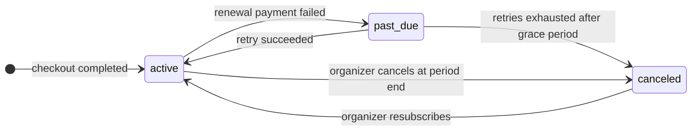
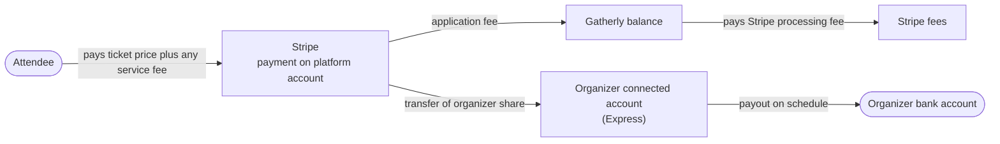
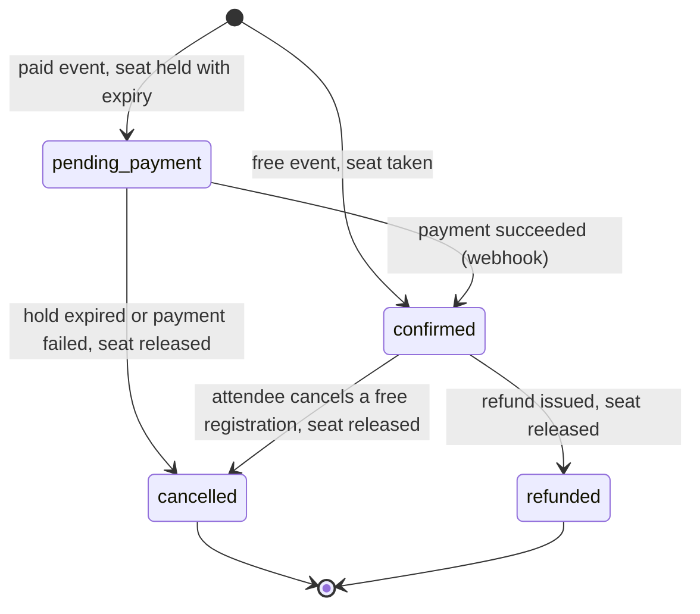
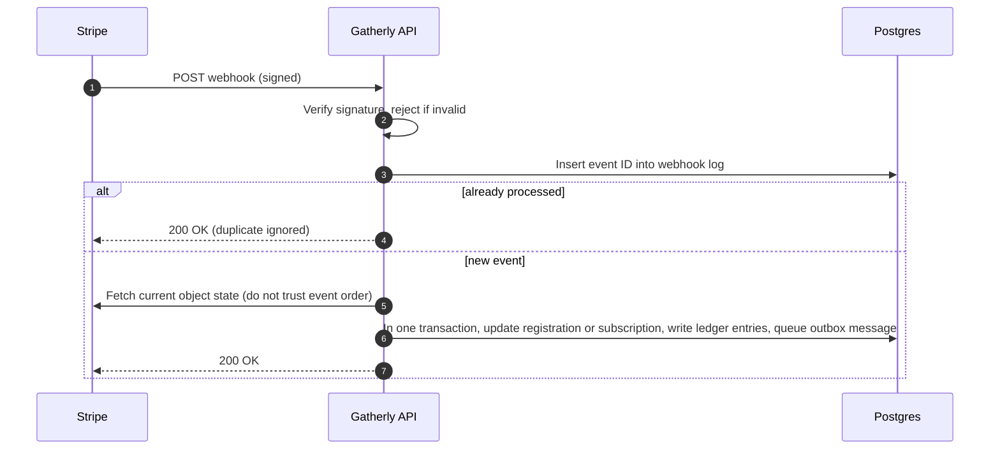

# Gatherly Monetization

**Status: designed, not built.** The MVP takes no money. It shows where money will flow (pricing page, plan badge, paywall, disabled paid-ticket field) and ships a data model that is ready for payments, so adding them later means new states and tables, not a rewrite.

Everything below is a set of **assumptions to validate with business stakeholders** (product, finance, legal). Prices and fee percentages are illustrative.

## At a glance

| Revenue stream | Who pays | What they get | Provider | Phase |
|---|---|---|---|---|
| Organizer subscription | Organizers | Premium plan: create events, later sell tickets and see analytics | Stripe Billing | Next |
| Ticketing fee | Attendees or organizers (organizer chooses) | Paid tickets with checkout, payouts and refunds | Stripe Connect Express | Later |

**Biggest risk: supply-side cold start.** Charging organizers before there are attendees to sell to can keep the events away, and without events there is nothing for attendees. That is why phase 0 of the [rollout](#9-rollout) validates the paywall before any Stripe Billing work.

**Why two streams.** Subscriptions give predictable revenue and filter out spam organizers. Ticket fees scale with organizer success, so Gatherly earns more when organizers do. Free events stay free for attendees, which keeps the community side of the marketplace healthy.

## 1. Assumptions to validate

| Assumption | Why we believe it | How to validate | If wrong |
|---|---|---|---|
| Organizers will pay a monthly fee to create events | Paid plans reduce spam and signal serious hosts | Checkout attempts (a signed-in member's "Upgrade" click calls `POST /billing/checkout`, visible in the per-route request metrics; no dedicated counter yet), interviews with 10 organizers | Free creation with limits (events per month) and monetize tickets only |
| Free events should stay free for attendees | Community meetups are the core use case | Share of events that are free in the first months | Optional "supporter" tip at registration |
| Organizers want to choose who pays the ticket fee | Competing platforms offer the choice; norms differ by community | Organizer survey; A/B test the default | Fix one default and remove the setting |
| USD only is enough at launch | Initial market is one country | Sign-up geography | Multi-currency is additive (section 7) |
| Payouts after the event are acceptable | Lowers refund and fraud risk | Organizer feedback on cash flow | Faster payouts for organizers with a good track record |

## 2. Subscription tiers and entitlements

Plans grant **entitlements**; code only ever asks "does this user have `events:create`?", never "is this user Premium?". Repackaging plans is a data change. See [ADR 0005](adr/0005-authorization-model.md).

| Capability | Entitlement | Free | Premium | Later tier (Organization) |
|---|---|---|---|---|
| Discover and register for free events | none | Yes | Yes | Yes |
| Create and manage events | `events:create` | No (paywall) | Yes | Yes |
| Sell paid tickets | `tickets:sell` | No | Yes (once paid tickets launch) | Yes |
| Attendee analytics and exports | `analytics:view` (proposed) | No | Yes | Yes |
| Co-organizers and team roles | `team:manage` (proposed) | No | No | Yes |

**Price points** are placeholders on the pricing page until validated. One monthly plan plus an annual discount is the starting hypothesis.

### Subscription lifecycle

Stripe Billing owns the subscription; Gatherly mirrors its status from webhooks and derives entitlements from it.

### Lapsed Premium behavior

The rule: **never punish attendees for an organizer's billing problem.**

**Status: the grace period is planned, not built.** Today only an `active` subscription grants entitlements, so a `past_due` organizer loses `events:create` at once (existing events and ownership are unaffected). The grace column below ships with Stripe Billing, when `past_due` first becomes a real state.

| Capability | Active | Past due (grace, e.g. 7 days) | Canceled (lapsed) |
|---|---|---|---|
| Existing events stay live and accept free registrations | Yes | Yes | Yes |
| Edit or cancel own existing events | Yes | Yes | Yes (ownership, not entitlement) |
| Create new events | Yes | Yes, with a warning banner | No (paywall) |
| Sell new paid tickets | Yes | Yes | Paused; tickets already sold are honored |
| Payouts for tickets already sold | Yes | Yes | Yes |

This works because authorization separates **entitlement** (what the plan grants) from **ownership** (what you already run).

## 3. Ticketing marketplace on Stripe Connect

### Account type: Express

| Option | Who owns onboarding, identity checks and payout dashboard | Fit |
|---|---|---|
| **Express (chosen)** | Stripe hosts onboarding and a light dashboard; Gatherly controls the checkout experience and fees | Best balance: little compliance work for us, consistent experience for attendees |
| Standard | Organizer owns a full Stripe account | Least work, but little control over refunds, fees and branding |
| Custom | Gatherly builds everything, owns compliance burden | Full white-label; too costly before product-market fit |

### Charge type: destination charges

Attendees pay Gatherly; Stripe moves the organizer's share to their connected account automatically and keeps Gatherly's application fee on the platform.

| Why destination charges | Tradeoff accepted |
|---|---|
| One checkout under the Gatherly brand; simple fee collection | Gatherly is responsible for refunds, disputes and the Stripe processing fee, so the platform fee must cover processing and a dispute reserve |
| Organizer share settles automatically | Multi-organizer splits (co-hosted events) would need separate charges and transfers |

### Fee options

Illustrative numbers: a $20.00 ticket, platform fee 5 percent plus $0.50, card processing about 2.9 percent plus $0.30.

| Option | Attendee pays | Organizer receives | Gatherly keeps after processing | Pros | Cons |
|---|---|---|---|---|---|
| A. Organizer absorbs the fee | $20.00 | $18.50 | about $0.62 | Clean price for attendees | Organizer earns less per ticket |
| B. Attendee pays a service fee | $21.50 | $20.00 | about $0.58 | Organizer gets the full ticket price | Higher checkout price; must be shown up front |
| **C. Organizer chooses per event (recommended), default B** | Either | Either | Either | Fits different community norms | One more setting and two price displays to test |

Rules that apply to every option:

- **Free events carry no fee.** Monetizing free meetups would hurt the core community.
- **Minimum fee floor** for cheap tickets, because Gatherly pays processing out of its fee under destination charges.
- **All-in price display:** the total, including fees, is shown before checkout starts, as price-transparency rules for live-event tickets require in several markets.

## 4. Seat hold during checkout

Paid checkout takes time, so the seat must be reserved while the attendee pays, or two people could pay for the last seat. This reuses the MVP's capacity mechanism: the same atomic conditional update that confirms a free registration creates a `pending_payment` registration with a `hold_expires_at`. A held seat counts against capacity. See [ADR 0006](adr/0006-capacity-concurrency.md).

All four statuses already exist in the MVP schema; the MVP uses only `confirmed` and `cancelled`.

| Decision | Choice | Why |
|---|---|---|
| Hold length | Match the checkout session lifetime (Stripe Checkout allows 30 minutes minimum) | A hold that ends before the payment page closes would let the seat be sold twice |
| Releasing expired holds | A sweeper job every minute, plus a check on read | Seats come back promptly even if no webhook arrives |
| Payment arrives after the hold expired | Try to take a seat again atomically; if the event is now full, refund automatically and notify the attendee | Money is never kept without a seat |
| Abandoned checkout | Expiring the checkout session releases the hold | No manual cleanup |

## 5. Refunds

| Situation | Proposed policy | Who absorbs the cost |
|---|---|---|
| Organizer cancels the event | Automatic full refund, including the service fee | Gatherly loses the processing fee (Stripe does not return it on refunds); the organizer's share is reversed |
| Attendee cancels within the organizer's refund window | Refund the ticket price; service fee kept | Organizer share reversed; Gatherly keeps its fee to cover processing |
| Attendee cancels outside the window | No refund; seat stays sold unless resale exists (later) | Attendee |
| Dispute or chargeback | Gatherly responds with evidence; if lost, recover by reversing the organizer transfer | Organizer, with Gatherly as backstop |

Organizers pick a refund window per event from a short list (none, up to 7 days before, up to 24 hours before, until start). **Payouts are released after the event ends**, which keeps refund money available; trusted organizers can earn earlier payouts later.

## 6. Webhooks, idempotency and ledger

Stripe is the source of truth for money; Gatherly's database is the source of truth for seats. Webhooks connect the two, and they arrive late, twice, or out of order.

| Concern | Design |
|---|---|
| Duplicate delivery | Unique Stripe event ID in a webhook log table; second delivery is a no-op |
| Out-of-order delivery | Re-read the current object from Stripe before acting |
| Our calls to Stripe | Idempotency key derived from registration ID plus action, so retries never double-charge or double-refund |
| Side effects (emails, receipts) | Written to an outbox in the same transaction; sent by a worker |
| Ledger | Append-only entries per money movement: attendee payment, platform fee, organizer payable, processing fee, refund, payout. Balances are sums, never edited |
| Reconciliation | Nightly job compares the ledger with Stripe balance transactions and alerts on any mismatch |

Planned tables: `connected_accounts` (organizer, Stripe account, charges and payouts enabled), `payments`, `ledger_entries`, `webhook_events`, `payouts`, and later `ticket_types` for tiers such as early bird.

## 7. Tax and currency

| Topic | Proposal | To confirm with |
|---|---|---|
| Sales tax and VAT | Stripe Tax on subscriptions and tickets | Finance and tax advisor: marketplace facilitator obligations differ by region |
| Organizer tax reporting | Stripe Connect files payout tax forms (1099-K) for US organizers | Finance |
| Currency | USD only at launch | Product |
| Multi-currency | Each event already stores `price_cents` and `currency`; amounts are always integer minor units. Adding currencies means a presentment currency per event, not a schema change | Finance (FX and payout currency rules) |

## 8. What is visible in the MVP

| Surface | Behavior | Why show it now |
|---|---|---|
| Pricing page | Free versus Premium plan cards; "Upgrade" opens a "coming soon" dialog (signed-out visitors go to sign-in) | Makes the business model concrete and measures interest |
| Plan badge and billing settings | Current plan shown in the header and settings | Users understand why some actions are locked |
| Paywall on "Create event" | Free users see an upgrade prompt; the API also rejects with `ENTITLEMENT_REQUIRED` | Proves the entitlement model end to end; UI is never the only check |
| Admin plan grant | Admins can set a user's plan (provider `comp`) | Lets reviewers turn an attendee into an organizer without real billing |
| Price field on events | Shown disabled with "Paid tickets coming soon"; the API rejects any price above zero with `PAID_TICKETS_UNAVAILABLE` | Schema and contract are ready; behavior is honest |
| Checkout endpoint | `POST /api/v1/billing/checkout` returns 501 `COMING_SOON` through a mock payment provider interface | The integration seam exists; swapping in Stripe touches one module |
| Registration statuses | Schema already includes `pending_payment` and `refunded` | Paid tickets add behavior, not migrations of core tables |

## 9. Rollout

| Phase | Scope | Exit criterion |
|---|---|---|
| 0. Validate the paywall | Founding organizers get Premium free for a fixed period (admin plan grant, `comp`); a comparison cohort gets a free tier capped at a few events a month. Measure events created per organizer, checkout attempts, retention and interview answers | Evidence that organizers will pay without starving supply; if not, ship capped free creation and monetize tickets instead |
| 1. Subscriptions | Stripe Billing checkout and customer portal, webhooks drive plan and entitlements | Organizers can upgrade, downgrade and lapse with correct access |
| 2. Paid tickets | Connect Express onboarding, seat holds, destination charges, ledger, payouts after the event | First paid event settles and reconciles to the cent |
| 3. Refund and dispute automation | Refund windows, automatic refunds on cancellation, dispute handling | Refund and dispute rates tracked on a dashboard |
| 4. Expansion | Stripe Tax everywhere, more currencies, ticket tiers, faster payouts for trusted organizers | Driven by demand |

### Open questions for stakeholders

1. Monthly price and annual discount for Premium?
2. Platform fee level and the default fee option (absorb or pass through)?
3. Refund windows to offer, and whether the service fee is ever refunded on attendee cancellations?
4. Payout timing: after the event for everyone, or earlier for trusted organizers?
5. Launch market and currency, and tax registration responsibilities?
