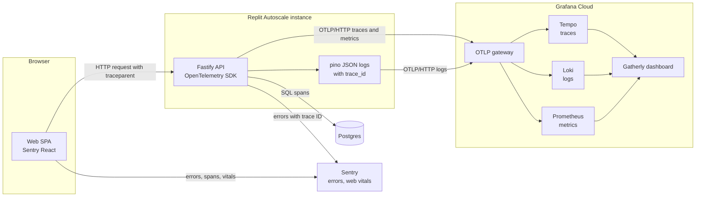

# Gatherly Observability

**Goal:** when something goes wrong, answer "what happened, to whom, and why" from one trace, without guessing. A click in the browser, the API request it caused, every SQL query, the log lines and any error all share one trace ID.

Built on free tiers: Grafana Cloud for traces, logs and metrics; Sentry for errors and web performance. Why no collector: see [ADR 0007](adr/0007-telemetry.md).

## Signals

| Signal | API | Web | Lands in |
|---|---|---|---|
| Traces | OpenTelemetry Node SDK with automatic instrumentation of HTTP, Fastify and Postgres | Sentry browser tracing; `traceparent` header sent to the API | Grafana Tempo, Sentry |
| Logs | Structured JSON (pino) with `trace_id` and `span_id` on every line; email redacted | none | Grafana Loki |
| Metrics | HTTP rate, errors and duration by route template, plus business counters | Web Vitals (load, interactivity, layout shift) | Grafana Prometheus, Sentry |
| Errors | Sentry Node, attached to the active trace | Sentry React with router integration and an error boundary screen | Sentry |
| Health | `/healthz`, `/readyz`, `/version` | none | Probes, humans |

## How a request is traced

A registration produces one trace: the browser span from Sentry, then the API request span, the guard checks, the conditional update, the insert and the commit. From a Sentry error you jump to the trace in Grafana by its trace ID; from any log line in Loki you jump to its trace in Tempo.

## Metrics catalog

| Metric | Type | Labels | Question it answers |
|---|---|---|---|
| HTTP request duration | Histogram | method, route template, status code | Is the API fast and healthy, per endpoint? (rate, errors and latency come from this one histogram) |
| `registrations_total` | Counter | `result`: confirmed, event_full, already_registered, event_started, event_cancelled | Are people getting seats? How often do events sell out? |
| `cancellations_total` | Counter | none | Are attendees dropping out? |
| `events_created_total` | Counter | none | Are organizers active? |

**Cardinality rule:** labels use route templates (`/events/:id`) and small fixed sets of values, never user IDs, event IDs or raw URLs. One unbounded label can exhaust the free tier's series limit and makes queries slow everywhere.

## Logs

| Practice | Why |
|---|---|
| JSON only, one event per line | Queryable in Loki without parsing rules |
| `trace_id` and `span_id` injected on every line | Jump from a log line to the full trace |
| Request log carries route template, status and duration | Matches the metrics, so logs explain spikes |
| Email addresses redacted | Personal data stays out of a third-party log store |
| `info` for request outcomes, `warn` for expected rejections, `error` for failures | Alerts and searches stay meaningful |

## Errors

**Only real failures go to Sentry.** A full event (`EVENT_FULL`) or a missing entitlement is the system working correctly, so it is counted in metrics, not reported as an error. Unhandled exceptions and 5xx responses are reported with the trace ID, the route and the user ID (never email). On the web, an error boundary shows a friendly recovery screen and reports the crash.

## Resource attributes and sampling

| Setting | Value | Why |
|---|---|---|
| `service.name` | `gatherly-api` (Sentry project for the web: `gatherly-web`) | Separates services in every backend |
| `service.version` | Git commit SHA | Ties a regression to a deploy |
| `deployment.environment` | `production` or `development` | Keeps local noise out of dashboards |
| Sampling | 100 percent | Demo volume is tiny; every trace is useful |

## Lifecycle on a scale-to-zero host

Autoscale stops idle instances. Telemetry is batched in memory, so the API handles SIGTERM by stopping intake, flushing OpenTelemetry and Sentry, and only then exiting. Without this, the last requests before shutdown (often the interesting ones) would vanish.

## Health endpoints

| Endpoint | Checks | Used for |
|---|---|---|
| `GET /healthz` | Process is up | Liveness; never touches the database, so a database outage does not cause restart loops |
| `GET /readyz` | Database answers a ping | Readiness; routes traffic only to instances that can serve it |
| `GET /version` | Git SHA and build time | "Which build is live?" in seconds |

## Dashboard

The repository ships one Grafana dashboard definition (`ops/grafana/`).

| Panel | Shows |
|---|---|
| Request rate by route | Traffic shape |
| Error rate by route | 5xx share; links to traces |
| Latency p50 and p95 by route | Slow endpoints |
| Registrations by result | Confirmed versus full versus duplicate over time |
| Cancellations and events created | Product activity |
| Recent error logs | Loki query filtered to `error`, each line linked to its trace |

## Where to look

| Symptom | First stop | Then |
|---|---|---|
| "I could not register" | Loki: logs for the user ID around the time | Trace for that request: which guard or rule rejected it |
| Event looks overbooked | `registrations_total` and the event row | The capacity test and check constraint make this a bug signal, not noise |
| API feels slow | Latency panel by route | Slowest traces in Tempo: database or application time? |
| Web page crashed | Sentry web issue | Linked API trace, if the crash followed a request |
| First request is slow | Trace shows long startup | Expected cold start on Autoscale ([ADR 0003](adr/0003-hosting.md)) |

## Next steps

| Step | Why | Trigger |
|---|---|---|
| OpenTelemetry Collector with tail sampling | Keep all errors and slow traces, sample the rest; route signals without app changes | Volume or cost grows; host can run a sidecar |
| SLOs with burn-rate alerts | Page on user pain, not on raw CPU | First real users |
| Real user monitoring (Grafana Faro) | Front-end performance next to back-end traces in one place | Web performance becomes a priority |
| Log retention policy | Control cost and personal data exposure | Before production |
| Audit log for admin actions | Who suspended whom, who changed a plan | Before production |
| Synthetic check on `/readyz` | Know the site is down before users do | Before production |

### Proposed SLOs

| User journey | Indicator | Target |
|---|---|---|
| Browse events | Share of event list and detail requests that succeed under 500 ms | 99 percent over 28 days |
| Register or cancel | Share of registration requests that complete without a 5xx | 99.9 percent over 28 days |
| Register latency | p95 duration of the registration endpoint | Under 300 ms |
