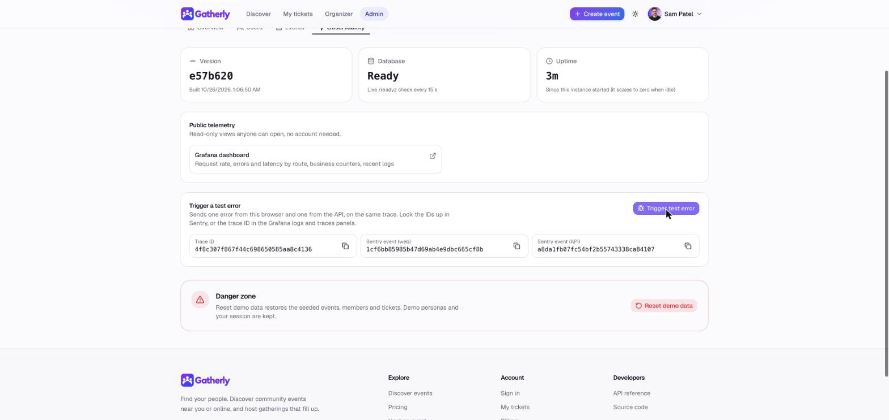
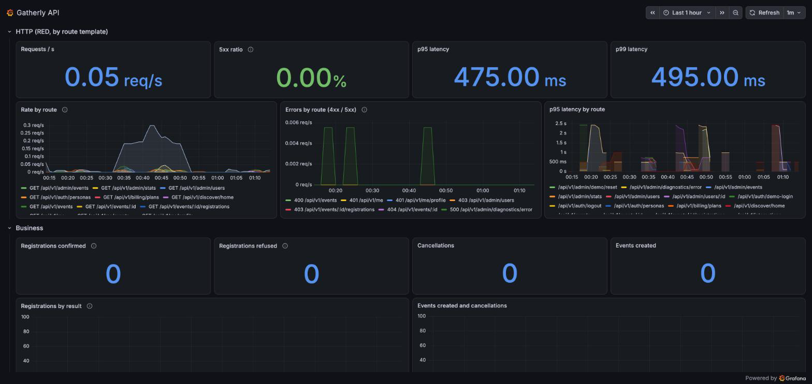
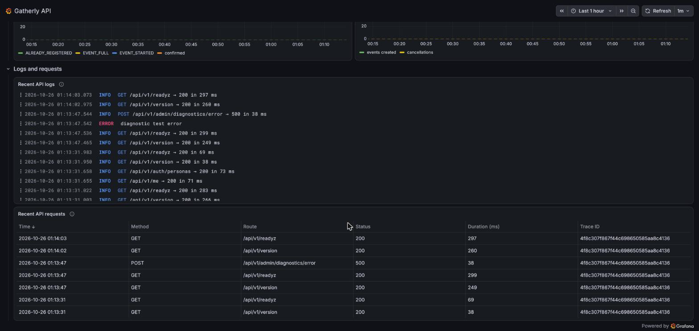
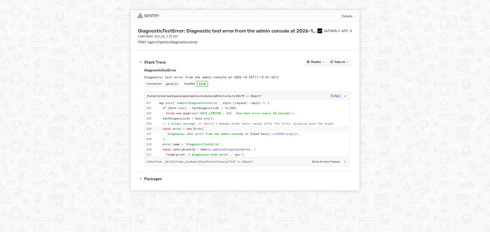
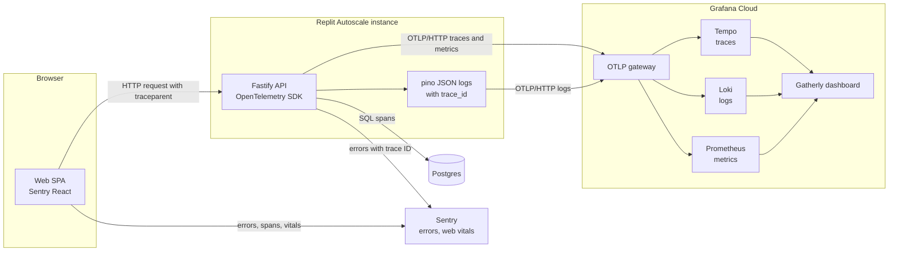

# Gatherly Observability

**Goal:** when something goes wrong, answer "what happened, to whom, and why" from one trace, without guessing. A click in the browser, the API request it caused, every SQL query, the log lines and any error all share one trace ID.

Built on free tiers: Grafana Cloud for traces, logs and metrics; Sentry for errors and web performance. Why no collector: see [ADR 0007](adr/0007-telemetry.md).

## Signals

| Signal | API | Web | Lands in |
|---|---|---|---|
| Traces | OpenTelemetry Node SDK with automatic instrumentation of HTTP, Fastify and Postgres | Sentry browser tracing; `traceparent` header sent to the API | Grafana Tempo, Sentry |
| Logs | Structured JSON (pino) with `trace_id` and `span_id` on every line; `userId` (the account UUID) on signed-in request lines; email redacted | none | Grafana Loki |
| Metrics | HTTP rate, errors and duration by route template, plus business counters | Web Vitals (load, interactivity, layout shift) | Grafana Prometheus, Sentry |
| Errors | Sentry Node, attached to the active trace | Sentry React with router integration and an error boundary screen | Sentry |
| Health | `/healthz`, `/readyz`, `/version` | none | Probes, humans |

## See it live (no account needed)

Reviewers can see real telemetry from the hosted demo without a Grafana or Sentry account.

| Where | What you see | How to get there |
|---|---|---|
| [Public Grafana dashboard](https://lankyholly1972.grafana.net/public-dashboards/9402737b590a4f538536e6057470aeba) | Request rate, errors and latency by API route; registrations, cancellations, events created; recent API logs; recent requests with their trace IDs. Read-only, time range picker on | Open the link |
| Sentry shared issues: [browser error](https://khandev-s1.sentry.io/share/issue/5d7cc0bd2b5a4701aba7387a0b4b86d1/) and [API error](https://khandev-s1.sentry.io/share/issue/25e21197641d4401a8ebfddb8027efa0/) | A browser error and the API error from the same trace, with stack traces | Open the links |
| Admin console, Observability tab | Live version, database readiness and uptime; links above; a **Trigger test error** button that sends a browser error and an API error on one trace and shows the trace ID and both Sentry event IDs | [Sign in as Sam (Admin)](https://gatherly--khanovicdev.replit.app/signin) (skip the onboarding steps), then Admin, then Observability |
| `x-trace-id` response header | The trace ID of any API response, to find it in the dashboard's logs and requests panels or in Sentry | Browser developer tools, Network tab |

A five-minute check: sign in as Sam, open the Observability tab, press **Trigger test error**, copy the trace ID, and find the same ID in the dashboard's **Recent API requests** table (the 500 on `/api/v1/admin/diagnostics/error`). The event count on the shared Sentry issues goes up by one.

### Why public links instead of accounts

| Option | Free tier reality | Verdict |
|---|---|---|
| Invite reviewers to Grafana and Sentry | Sentry's free plan has one seat. Grafana's free plan allows three users and needs each reviewer's email in advance | Does not fit anonymous reviewers |
| Share one login | Credentials leave our control; a reviewer could change settings or tokens | Never |
| Public, read-only links | Grafana public dashboards and Sentry shared issues need no account, cannot change anything, and can be revoked in one click | Chosen |

### Guardrails

| Risk | Control |
|---|---|
| Personal data in public panels | Request logs carry only method, route template, status, duration, trace ID and, when signed in, `userId` (the account UUID); Fastify's default request log (raw URL and client IP) is off. The logs panel also uses a LogQL `keep` allowlist, so older lines with extra fields stay hidden. Email is redacted at the logger |
| Personal data in Sentry | The API SDK collects no user info, cookies or bodies and only a short allowlist of request headers, so the proxy's client IP and Replit profile headers never leave the app. "Prevent Storing of IP Addresses" is on for both projects. Shared issues were created after both changes; older issues are deleted, not shared. Sentry still derives an approximate location (city) from the visitor's connection |
| Free-form queries by viewers | Public dashboards run only the saved panel queries; there is no query editor or Explore |
| Abuse of the test error | The diagnostics endpoint is admin-only and limited to one error every 10 seconds per instance |
| Metric cardinality | Only API requests are traced and measured, labelled by route template; static files are skipped |
| Stale or leaked links | Both links can be revoked or rotated from Grafana and Sentry at any time; no secret is embedded in them |

### Production path

| Today (demo) | Production |
|---|---|
| Public dashboard link | Single sign-on into Grafana with a read-only Viewer role mapped from the identity provider's groups; public dashboards turned off for anything with user data |
| Shared Sentry issues | Sentry Team plan with SSO, team-scoped projects and per-person access; shared links off by default |
| Demo admin can trigger test errors | Synthetic checks and a staging environment exercise the error path; no test-error endpoint in production |
| Allowlisted log fields | Same allowlist, plus a written retention period and a data-processing agreement with each vendor |

### Limits of the free setup

| Limit | Effect |
|---|---|
| Public dashboards cannot query Tempo | The public dashboard lists recent requests and trace IDs from the logs; the full span waterfall needs a Grafana account |
| Grafana Cloud trial ends 2026-11-08 | The stack then drops to the free tier: 10,000 active metric series, 50 GB of logs and 50 GB of traces a month, 14-day retention. Gatherly uses well under that: 350 to 550 active series per running build (none for static files), about 5 MB of logs and 15 MB of traces a day |
| Scale to zero | After a quiet period the first request starts the instance, so panels show gaps and a slow first request |
| Sentry free plan | One seat and a monthly error quota; the diagnostics rate limit keeps test errors far below it |

## How a request is traced

A registration produces one trace: the browser span from Sentry, then the API request span, the guard checks, the conditional update, the insert and the commit. From a Sentry error you jump to the trace in Grafana by its trace ID; from any log line in Loki you jump to its trace in Tempo.

## Metrics catalog

| Metric | Type | Labels | Question it answers |
|---|---|---|---|
| HTTP request duration | Histogram | method, route template, status code | Is the API fast and healthy, per endpoint? (rate, errors and latency come from this one histogram) |
| `registrations_total` | Counter | `result`: `confirmed` or the refusing error code in lowercase: `event_full`, `already_registered`, `event_started`, `event_cancelled` (and rarely `not_found` or `internal`) | Are people getting seats? How often do events sell out? |
| `cancellations_total` | Counter | none | Are attendees dropping out? |
| `events_created_total` | Counter | none | Are organizers active? |
| `saves_total` | Counter | none | Is discovery surfacing events people want? |
| `hides_total` | Counter | none | Is the ranker showing events people reject? |

**Cardinality rule:** labels use route templates (`/events/:id`) and small fixed sets of values (error codes are a closed enum), never user IDs, event IDs or raw URLs. One unbounded label can exhaust the free tier's series limit and makes queries slow everywhere.

## Logs

| Practice | Why |
|---|---|
| JSON only, one event per line | Queryable in Loki without parsing rules |
| `trace_id` and `span_id` injected on every line | Jump from a log line to the full trace |
| One request line with route template, status, duration and, when signed in, `userId` | Matches the metrics, so logs explain spikes; support can find one person's requests from their account. The UUID is random and carries no email or name; hashing it per environment is the next step if logs must not be joinable to the database |
| No client IP addresses, raw URLs or query strings | Search text and IPs are personal data; the route template is enough to debug |
| Email addresses redacted | Personal data stays out of a third-party log store |
| One `info` line per request, including expected 4xx rejections; `error` only for 5xx and unhandled failures | Alerts and searches stay meaningful; rejections are counted by status, not logged as problems |

## Errors

**Only real failures go to Sentry.** A full event (`EVENT_FULL`) or a missing entitlement is the system working correctly, so it is counted in metrics, not reported as an error. Unhandled exceptions and 5xx responses are reported with the trace ID, the route and `user.id` (the account UUID; no email, no IP). On the web, an error boundary shows a friendly recovery screen and reports the crash.

## Resource attributes and sampling

| Setting | Value | Why |
|---|---|---|
| `service.name` | `gatherly-api` (Sentry project for the web: `gatherly-web`) | Separates services in every backend |
| `service.version` | Git commit SHA | Ties a regression to a deploy |
| `deployment.environment` | `production` or `development` | Keeps local noise out of dashboards |
| Sampling | 100 percent | Demo volume is tiny; every trace is useful |

## Lifecycle on a scale-to-zero host

Autoscale stops idle instances. Telemetry is batched in memory, so the API handles SIGTERM by stopping intake, flushing OpenTelemetry and Sentry, and only then exiting. Without this, the last requests before shutdown (often the interesting ones) would vanish.

## Health endpoints

| Endpoint | Checks | Used for |
|---|---|---|
| `GET /healthz` | Process is up | Liveness; never touches the database, so a database outage does not cause restart loops |
| `GET /readyz` | Database answers a ping | Readiness; routes traffic only to instances that can serve it |
| `GET /version` | Git SHA, build time and uptime | "Which build is live, and did it just restart?" in seconds |

## Dashboard

The repository ships one Grafana dashboard definition (`ops/grafana/dashboard.json`). It uses the default Grafana Cloud datasource names and no template variables, so the same file imports into any Grafana Cloud stack and can be shared publicly.

| Panel | Shows |
|---|---|
| Requests per second, 5xx ratio, p95 and p99 latency | Health at a glance, API routes only |
| Rate, errors and p95 latency by route | Which endpoint is busy, failing or slow |
| Registrations confirmed and refused, cancellations, events created | Product activity over the selected range |
| Registrations by result | Confirmed versus full versus duplicate over time |
| Recent API logs | Allowlisted request lines and error lines |
| Recent API requests | Time, method, route, status, duration and trace ID, built from the logs |

## Where to look

| Symptom | First stop | Then |
|---|---|---|
| "I could not register" | Loki: request lines with the person's `userId` around the time | Trace for that request: which guard or rule rejected it |
| Event looks overbooked | `registrations_total` and the event row | The capacity test and check constraint make this a bug signal, not noise |
| API feels slow | Latency panel by route | Slowest traces in Tempo: database or application time? |
| Web page crashed | Sentry web issue | Linked API trace, if the crash followed a request |
| First request is slow | Trace shows long startup | Expected cold start on Autoscale ([ADR 0003](adr/0003-hosting.md)) |

## Next steps

| Step | Why | Trigger |
|---|---|---|
| OpenTelemetry Collector with tail sampling | Keep all errors and slow traces, sample the rest; route signals without app changes | Volume or cost grows; host can run a sidecar |
| SLOs with burn-rate alerts | Page on user pain, not on raw CPU | First real users |
| Real user monitoring (Grafana Faro) | Front-end performance next to back-end traces in one place | Web performance becomes a priority |
| Log retention policy | Control cost and personal data exposure | Before production |
| Audit log for admin actions | Who suspended whom, who changed a plan | Before production |
| Synthetic check on `/readyz` | Know the site is down before users do | Before production |

### Proposed SLOs

| User journey | Indicator | Target |
|---|---|---|
| Browse events | Share of event list and detail requests that succeed under 500 ms | 99 percent over 28 days |
| Register or cancel | Share of registration requests that complete without a 5xx | 99.9 percent over 28 days |
| Register latency | p95 duration of the registration endpoint | Under 300 ms |
