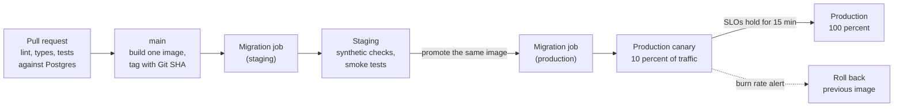
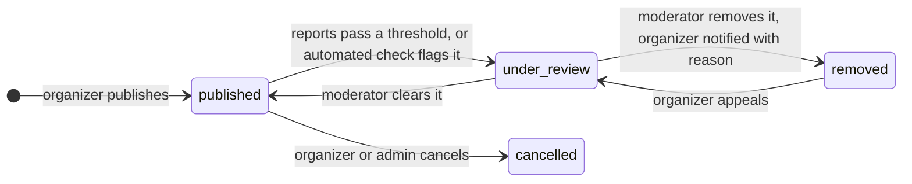

# Gatherly Operations, Cross-cutting Concerns and Trust & Safety

How Gatherly would run in production, what it owes users beyond features, and how it resists abuse. Each row says what exists today, what production needs, and why. Nothing here is built unless the "Today" column says so; the ordered plan is in the [roadmap](roadmap.md).

## 1. Operations

### Environments and delivery

| Concern | Today | Production | Why |
|---|---|---|---|
| Environments | One hosted demo, local Docker, CI | Preview per pull request (seeded, `DEMO_MODE=true`), staging, production; production never runs demo mode | Every change is seen running before users see it |
| Build and promotion | Replit builds from the repository on publish | CI builds one image per commit, tagged with the Git SHA; staging and production run the same image with different config | "It worked in staging" means the same bytes |
| Rollout | Replace in place | Canary to a slice of traffic, automatic rollback on SLO burn | Bad releases reach a few users for minutes, not everyone for hours |
| Rollback | Republish the previous version | Redeploy the previous image tag in one command; a written runbook covers the database side | Code rolls back in seconds only if migrations stayed backward compatible |
| Configuration and secrets | Replit Secrets and `.env`, validated at start | Secret manager with rotation and per-environment access; config still validated at start | A missing secret fails the deploy, not a request |

### Database

| Concern | Today | Production | Why |
|---|---|---|---|
| Backups | Hosted Postgres as provided by the free plan; no restore ever tested | Managed Postgres with daily snapshots and point-in-time recovery (7 to 30 days of WAL) in a second region | Registrations and payments are the record of who holds a seat |
| Targets | None defined | **RPO 5 minutes, RTO 1 hour** for the primary database | Losing five minutes of registrations is recoverable by support; losing a day is not |
| Restore drill | None | Quarterly: restore PITR to a scratch instance, run the app's readiness and a row-count check, record the time against the RTO | A backup is only real once it has been restored |
| Migrations | Run in each instance's start command before it listens | A separate one-off job per release, before traffic shifts, holding a Postgres advisory lock so two jobs never run at once | Instances that start together must not race on schema changes; a failed migration stops the release, not the running app |
| Zero-downtime changes | Not needed yet (one instance, few rows) | Expand and contract: add nullable or defaulted columns, backfill in batches, switch reads, drop the old column a release later; create indexes concurrently; set a lock timeout on every migration | Keeps the previous image working during a rollout or rollback |
| Connections | Small pool per instance | Pooler (PgBouncer or the provider's) in transaction mode | Autoscaling multiplies pools; Postgres connections are scarce |

### Feature flags

| Flag | Use | Why |
|---|---|---|
| `DEMO_MODE` (exists) | Demo sign-in, demo reset, seeding on start | Production must not be able to turn into a demo by accident; off unless set |
| Ranker version | Which `Ranker` serves which share of traffic; `rules-v1` is the default and the fallback | A new ranker launches as a holdout or canary and rolls back without a deploy ([ADR 0009](adr/0009-rule-based-ranker.md)) |
| Product flags | Waitlist, paid tickets, new onboarding steps, per environment and per user cohort | Ship dark, enable gradually, kill fast |

Flags start as environment config and move to a flag service (or a small table) when product needs per-user targeting. Every flag has an owner and a removal date.

### On-call and incidents

| Practice | Rule |
|---|---|
| Alerts | Page only on SLO burn rate (fast and slow windows) and on readiness failing from outside; everything else is a ticket |
| Rotation | One primary and one secondary per week once there are real users; the alert links to a runbook |
| Severity | SEV1: registrations or sign-in down for everyone. SEV2: a feature or segment broken. SEV3: degraded, workaround exists |
| During an incident | One incident lead, one channel, a status page update within 15 minutes for SEV1; stabilize (roll back first) before diagnosing |
| After | Blameless review within five working days for SEV1 and SEV2, with owned follow-ups |
| Runbooks | Roll back a release, restore from PITR, rotate a leaked secret, revoke all sessions, disable a ranker version, put an event behind a waiting room |

### SLOs

The journeys, indicators and targets are in [observability](observability.md#proposed-slos): browse at 99 percent under 500 ms, register or cancel at 99.9 percent without a 5xx, register p95 under 300 ms. Error budgets decide pace: when a budget is spent, releases pause for reliability work.

## 2. Cross-cutting concerns

| Concern | Today | Before real users | Tradeoff or note |
|---|---|---|---|
| Accessibility | shadcn/ui on Radix primitives (keyboard and screen-reader behavior), semantic HTML, visible focus | WCAG 2.2 AA as the bar: automated checks (axe) in CI, a manual screen-reader pass on register and checkout, color contrast in both themes | Retrofitting accessibility costs more than building with it; the component library is the head start |
| Internationalization | English only; times stored in UTC and shown in the event's time zone; money in integer minor units | Extract strings for translation, locale-aware dates and numbers; search configured per language | Full-text search uses the `english` dictionary, so stemming fails for other languages; a per-event language column and dictionary, or a search engine, fixes it |
| Privacy rights (GDPR, CCPA) | Data minimization, first-party anonymous ID, no third-party trackers, retention proposed ([ADR 0010](adr/0010-interaction-data.md)) | Self-service export and deletion (deletion anonymizes registrations, see ADR 0010), enforced retention job, records of processing, data-processing agreements with Grafana, Sentry and the email provider, honoring Global Privacy Control | Personalization is legitimate interest only with notice and an off switch; EU launch needs both |
| PCI DSS scope | No card data | Stripe Checkout and Connect hosted pages, so card data never touches Gatherly: scope stays at **SAQ A** | Embedding a custom card form would raise scope; hosted checkout trades some UX control for that |
| Cost | Free tiers: Replit Autoscale, Grafana Cloud, Sentry | Rough first-year model below | Each line has a trigger to upgrade, not a date |

**Cost model at first real traffic** (order of magnitude, monthly): managed Postgres with PITR and a replica-ready plan, about $50 to $100; two always-warm app instances, about $30 to $60; Grafana Cloud and Sentry team plans, about $50 to $80; email provider, under $20 at tens of thousands of messages. Roughly $150 to $250 a month before payments; Stripe fees are per transaction and covered by the platform fee ([monetization](monetization.md)). The biggest variable is telemetry volume, which tail sampling caps.

## 3. Trust and safety

The demo protects itself (protected personas, demo mode, limits). A public platform needs more, because organizers publish content, attendees compete for scarce seats, and money will move.

### Administration

| Control | Today | Production | Why |
|---|---|---|---|
| Admin roles | One `admin` role with every power | Scoped roles: support (read, suspend), moderator (content), finance (refunds, payouts), super admin (roles) | Least privilege; one stolen support account cannot move money |
| Audit log | None | Append-only table of every admin action: who, what, target, before and after, reason, trace ID; visible to super admins, exported for retention | Accountability for suspensions and plan changes; evidence in disputes |
| Admin sign-in | Same as members | SSO through the company identity provider with MFA required; admin sessions shorter and bound to re-authentication for destructive actions | Admin accounts are the highest-value target |

### Content moderation

| Piece | Design |
|---|---|
| Moderation status | A `moderation_status` on events (published, under review, removed), separate from the organizer's own `status`, so cancelling and removing stay distinct |
| Reports | "Report this event" with a reason (spam, scam, unsafe, offensive); one report per user per event; a threshold or a trusted reporter moves the event to review |
| Under review | Stays visible to registered attendees with a notice; hidden from discovery and search; new registrations paused |
| Removed | Hidden everywhere; active registrations cancelled (and refunded once paid tickets exist); organizer told why; appeal once |
| Automated checks | Link and keyword screening on publish; new organizers' first events can require review |

### Suspended organizers

Suspending an organizer blocks their sign-in today but leaves their events published. Production rule: suspension moves the organizer's upcoming events to **under review**: hidden from discovery, registrations paused, existing attendees notified. A moderator then reinstates or removes them; removal cancels registrations and refunds. Past events stay for history. This keeps one bad actor from continuing to collect sign-ups (or money) after the platform has acted.

### Seat squatting and bots

Free events with scarce seats invite bots and hoarding: one person registering many accounts to hold seats or resell them.

| Control | Design | Why |
|---|---|---|
| Verified email to register | Registration requires a verified email; sign-up is already rate-limited per IP (sign-in per IP and per email) | Raises the cost of each fake account |
| Per-account caps | One active registration per event already (partial unique index); add a cap on active registrations per account in a time window, and per IP per event | Stops one account from holding a whole calendar |
| CAPTCHA on hot events | A challenge (Turnstile or similar) only when an event is filling fast or traffic looks automated | Friction only where seats are contested |
| Shorter holds per account | For paid checkout, the seat hold is per account and short; repeated abandoned holds shorten the next hold or block holds for a while | Prevents holding seats through endless checkouts |
| Waiting room | For a mega-event, a queue in front of registration ([scaling](architecture.md#8-scaling-considerations)) | Fairness and database protection in one step |

### Payments fraud

| Risk | Control |
|---|---|
| Card testing (many small attempts with stolen cards) | Stripe Radar rules, rate limits per account and IP on checkout, CAPTCHA after failures, minimum ticket price above trivial amounts |
| Organizer fraud (sell tickets, cancel, vanish) | Payouts after the event; reserves for new organizers; Connect identity verification ([monetization](monetization.md)) |
| Chargebacks | Evidence from the audit log and registration history; recover from the organizer's balance |

## 4. Ranking data integrity

The ranker will be evaluated and trained on logged data, so that data must be complete and hard to forge.

| Concern | Today | Production | Why |
|---|---|---|---|
| What was served | The response carries `rankerVersion` and a request ID; the browser logs impressions it saw | A **server-side serving log**: for every ranked response, the request ID, ranker version, candidate count and the ordered event IDs with scores, written by the API | Offline evaluation needs what was shown and in what order, including items the browser never reported; client logs alone are lossy and biased by ad blockers |
| Outcomes | The client may send `save`, `hide`, `register`, `cancel` interactions | Outcomes derived on the server from the real writes (save, hide, registration, cancellation rows) and joined to the serving log by request ID; client-sent outcome types ignored for training | A client can forge an interaction; it cannot forge a registration row |
| Client events | Impressions and clicks, rate-limited, validated, tied to a session or anonymous ID | Same, plus dedupe by request ID and position, and bot filtering before training | Impressions and clicks only exist on the client; they are useful but untrusted |

Details on what is collected and kept: [ADR 0010](adr/0010-interaction-data.md).
