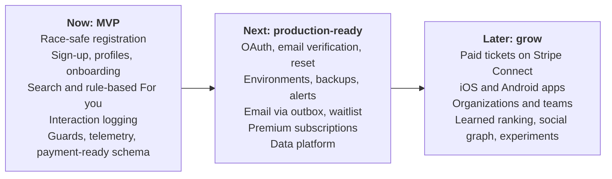
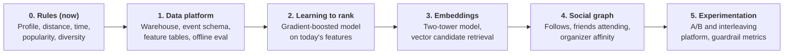

# Gatherly Roadmap

Three horizons. **Now** is what this repository delivers. **Next** is what must happen before real users and real money. **Later** grows the product once the core is proven. Each item names why it sits where it does.

## Now: the MVP in this repository

| Item | Why it is in the MVP |
|---|---|
| Event creation, registration, capacity limit, cancellation | The brief's core workflow |
| Race-safe capacity with a concurrency test | Overbooking is the most damaging bug this domain can have |
| Role, entitlement and ownership guards; permission matrix | Authorization is expensive to retrofit; the brief asks how roles access the system |
| Demo persona sign-in with protected personas and demo reset | Reviewers try every role in one click; public demo stays usable |
| Email and password sign-up, private preferences, public profiles, three-step onboarding | Real accounts that remember people; see [ADR 0008](adr/0008-password-signup.md) |
| Weighted full-text search with typo tolerance, distance and format filters | Finding the right event is the product's front door |
| Rule-based "For you" ranking with reasons, home rails, save and "not interested" | Personal from the first visit, explainable, no data needed; see [ADR 0009](adr/0009-rule-based-ranker.md) |
| Interaction logging with ranker version and position | Every later personalization stage needs this history; see [ADR 0010](adr/0010-interaction-data.md) |
| Realistic seeded community (about 200 members, preference-driven registrations) | Seat counts, attendee lists and popularity are real rows, so the demo behaves like a live city |
| Web app: discover, event detail, my registrations, organizer and admin pages, pricing | Shows the whole product, not only the API |
| Traces, logs, metrics, errors, dashboard, health endpoints | Production habits from day one cost little and pay off immediately |
| Payment-ready schema (registration statuses, price and currency), pricing page, paywall | Monetization becomes additive, not a rewrite |
| CI with lint, type check, tests against Postgres, build | Every change is checked |

## Next: before real users

| Item | Why next | Depends on |
|---|---|---|
| OAuth sign-in (Google, Apple, Facebook), email verification, password reset; MFA for admins | Password-only accounts without verification or recovery are not production-ready | Session layer (exists), email via outbox, stable domain |
| Rate limiting, security headers, dependency scanning | Basic protection once the URL is public for real | none |
| Audit log for admin actions | Accountability for suspensions and plan changes | none |
| Staging and production environments; managed Postgres with point-in-time recovery; minimum warm instances | Safe releases, no data loss, no cold starts for users | Paid hosting decision |
| SLOs with alerts; synthetic check on readiness | Know about outages before users report them | Telemetry (exists) |
| Email confirmations, reminders and cancellation notices through a transactional outbox | Attendees expect them; an outbox keeps email failures from failing registrations | Job runner |
| Waitlist with automatic promotion when a seat frees | Sold-out events are where demand is highest | Email, product decision on promotion rules |
| Premium subscriptions on Stripe Billing | First revenue; turns the existing paywall live | Real sign-in, webhook handling |
| Add-to-calendar and event-local time everywhere | Fewer no-shows | none |
| Personalization data platform (stage 1 below) | Offline evaluation and training need clean, exported interaction history | Real traffic |

## Later: grow the product

| Item | Why later | Depends on |
|---|---|---|
| Paid tickets on Stripe Connect with seat holds, refunds and a ledger | Needs legal, tax and refund policy decisions; see [monetization](monetization.md) | Subscriptions, outbox, payment-ready schema |
| iOS and Android apps (React Native with Expo), push notifications, offline tickets | Web is mobile-first already; native adds store presence and push | Real sign-in with PKCE, outbox for push |
| Organizations with team roles (co-organizers, check-in staff) | Larger organizers share work | Authorization model extension |
| Check-in at the door (QR codes) | Attendance data for organizers | Mobile apps or web scanner |
| Search engine and PostGIS when one city outgrows Postgres search | Postgres search covers one city; more cities need geo indexes and faster relevance tuning | Catalog growth |
| Image uploads to object storage with a CDN | Organizers want their own covers | Moderation policy |
| Collector with tail sampling; real user monitoring | Telemetry cost and depth at scale | Hosting that can run a collector |
| Multi-currency, more tax regions, localization | International growth | Paid tickets |

## Personalization stages

Each stage is entered only when its trigger is met, because each one costs more and needs the data the previous stage produced. The `Ranker` interface and ranker versioning ([ADR 0009](adr/0009-rule-based-ranker.md)) mean every stage swaps the scorer without changing the API.

| Stage | What it adds | Why at this point | Enter when |
|---|---|---|---|
| 0. Rules (now) | Weighted score over interests, tags, distance, time-slot fit, popularity and recency; diversity rerank; reasons on every card; interactions logged with ranker version | No behavior data yet; explainable and testable | Done |
| 1. Data platform | Interactions exported to a warehouse, versioned event schema, daily feature tables, an offline evaluation harness that replays logged traffic | Models need clean history and a way to score rankers before users see them | Real users generate steady traffic; Postgres analysis queries get slow |
| 2. Learning to rank | A gradient-boosted ranking model trained on clicks, saves and registrations, using the same features as the rules; shipped as a new ranker version | Learns weights from behavior instead of guesses; still explainable by feature | Enough registrations with logged impressions to beat `rules-v1` offline |
| 3. Embeddings and two-tower retrieval | User and event embeddings; nearest-neighbor candidate retrieval (pgvector first) | Finds relevant events beyond exact category and tag matches; scales candidate generation | Catalog too large to score every candidate; new events need cold-start matching by content |
| 4. Social graph | Follows, "friends going", organizer affinity as ranking signals | Social proof is the strongest reason to attend a community event | Follow and friend features exist and are used |
| 5. Experimentation platform | Assignment service, A/B tests and interleaving, guardrail metrics (registrations, hides, cancellations) | Online proof that a ranker helps; protects against offline wins that hurt users | Several ranker versions compete; until then, a simple holdout group per launch |

## Not now

Deliberately left out of the MVP. Each has a reason and a stage where it lands.

| Item | Why not now | Lands in |
|---|---|---|
| OAuth providers (Google, Apple, Facebook) | App registrations, stable redirect URIs, a paid Apple developer account | Next |
| Email verification and password reset ("Forgot password?" shows "coming soon") | Needs an email provider and an outbox | Next |
| Follows and friends | Social features need moderation and privacy controls first | Personalization stage 4 |
| Machine-learned ranking | No real behavior data to learn from | Personalization stage 2 |
| Embeddings and pgvector | Catalog and traffic too small to benefit | Personalization stage 3 |
| A/B testing | One ranker version; nothing to compare yet | Personalization stage 5 |
| Warehouse export | Postgres handles current volume | Personalization stage 1 |
| Avatar upload | Needs object storage, resizing and moderation | Later (image uploads) |

## Explicitly not planned

| Item | Why not |
|---|---|
| Microservices | One team, one domain; a modular monolith with clear module boundaries splits later if load or team structure demands it |
| Building our own payments or identity | Commodity problems with high risk; providers do them better |
| Real-time seat counters over websockets | Polling plus optimistic UI is enough until events sell out in seconds |
