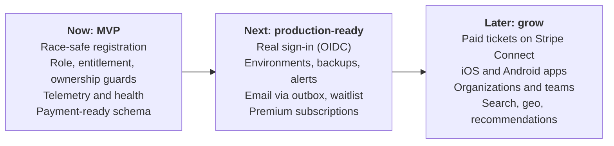

# Gatherly Roadmap

Three horizons. **Now** is what this repository delivers. **Next** is what must happen before real users and real money. **Later** grows the product once the core is proven. Each item names why it sits where it does.

## Now: the MVP in this repository

| Item | Why it is in the MVP |
|---|---|
| Event creation, registration, capacity limit, cancellation | The brief's core workflow |
| Race-safe capacity with a concurrency test | Overbooking is the most damaging bug this domain can have |
| Role, entitlement and ownership guards; permission matrix | Authorization is expensive to retrofit; the brief asks how roles access the system |
| Demo persona sign-in with protected personas and demo reset | Reviewers try every role in one click; public demo stays usable |
| Web app: discover, event detail, my registrations, organizer and admin pages, pricing | Shows the whole product, not only the API |
| Traces, logs, metrics, errors, dashboard, health endpoints | Production habits from day one cost little and pay off immediately |
| Payment-ready schema (registration statuses, price and currency), pricing page, paywall | Monetization becomes additive, not a rewrite |
| CI with lint, type check, tests against Postgres, build | Every change is checked |

## Next: before real users

| Item | Why next | Depends on |
|---|---|---|
| Real sign-in through an OIDC provider; MFA for admins | Demo personas are not identity | Session layer (exists) |
| Rate limiting, security headers, dependency scanning | Basic protection once the URL is public for real | none |
| Audit log for admin actions | Accountability for suspensions and plan changes | none |
| Staging and production environments; managed Postgres with point-in-time recovery; minimum warm instances | Safe releases, no data loss, no cold starts for users | Paid hosting decision |
| SLOs with alerts; synthetic check on readiness | Know about outages before users report them | Telemetry (exists) |
| Email confirmations, reminders and cancellation notices through a transactional outbox | Attendees expect them; an outbox keeps email failures from failing registrations | Job runner |
| Waitlist with automatic promotion when a seat frees | Sold-out events are where demand is highest | Email, product decision on promotion rules |
| Premium subscriptions on Stripe Billing | First revenue; turns the existing paywall live | Real sign-in, webhook handling |
| Add-to-calendar and event-local time everywhere | Fewer no-shows | none |

## Later: grow the product

| Item | Why later | Depends on |
|---|---|---|
| Paid tickets on Stripe Connect with seat holds, refunds and a ledger | Needs legal, tax and refund policy decisions; see [monetization](monetization.md) | Subscriptions, outbox, payment-ready schema |
| iOS and Android apps (React Native with Expo), push notifications, offline tickets | Web is mobile-first already; native adds store presence and push | Real sign-in with PKCE, outbox for push |
| Organizations with team roles (co-organizers, check-in staff) | Larger organizers share work | Authorization model extension |
| Check-in at the door (QR codes) | Attendance data for organizers | Mobile apps or web scanner |
| Full-text and "near me" search; recommendations | Discovery matters once there are many events | Search engine or PostGIS |
| Image uploads to object storage with a CDN | Organizers want their own covers | Moderation policy |
| Collector with tail sampling; real user monitoring | Telemetry cost and depth at scale | Hosting that can run a collector |
| Multi-currency, more tax regions, localization | International growth | Paid tickets |

## Explicitly not planned

| Item | Why not |
|---|---|
| Microservices | One team, one domain; a modular monolith with clear module boundaries splits later if load or team structure demands it |
| Building our own payments or identity | Commodity problems with high risk; providers do them better |
| Real-time seat counters over websockets | Polling plus optimistic UI is enough until events sell out in seconds |
