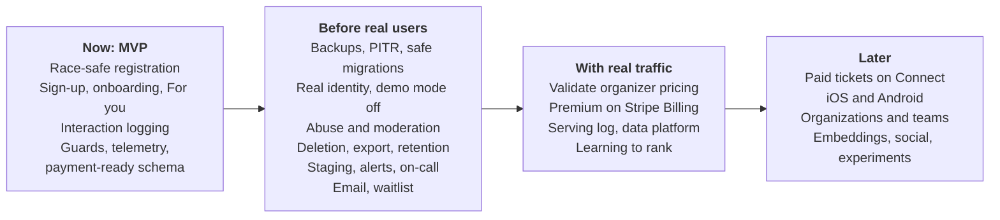
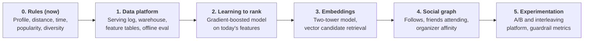

# Gatherly Roadmap

Four horizons, each with a gate. **Now** is what this repository delivers. **Before real users** is the launch gate, ordered by the damage each gap could do. **With real traffic** starts only when real people use the product, because it needs their data or their money. **Later** grows the product once the core is proven. Every item names its trigger, so the order is a decision, not a wish list.

## Now: the MVP in this repository

| Item | Why it is in the MVP |
|---|---|
| Event creation, registration, capacity limit, cancellation | The brief's core workflow |
| Race-safe capacity with a concurrency test; database check constraints | Overbooking is the most damaging bug this domain can have |
| Role, entitlement and ownership guards; permission matrix | Authorization is expensive to retrofit; the brief asks how roles access the system |
| Demo mode: persona sign-in, protected personas, scoped demo reset | Reviewers try every role in one click; the public demo stays usable and real sign-ups stay safe |
| Email and password sign-up, private preferences, public profiles, three-step onboarding | Real accounts that remember people; see [ADR 0008](adr/0008-password-signup.md) |
| Weighted full-text search with typo tolerance, distance and format filters | Finding the right event is the product's front door |
| Rule-based "For you" ranking with reasons, home rails, save and "not interested" | Personal from the first visit, explainable, no data needed; see [ADR 0009](adr/0009-rule-based-ranker.md) |
| Interaction logging with ranker version and position | Every later personalization stage needs this history; see [ADR 0010](adr/0010-interaction-data.md) |
| Realistic seeded community (about 200 members, preference-driven registrations) | Seat counts, attendee lists and popularity are real rows, so the demo behaves like a live city |
| Web app: discover, event detail, my registrations, organizer and admin pages, pricing | Shows the whole product, not only the API |
| Traces, logs, metrics, errors, dashboard, health endpoints; rate limits, security headers | Production habits from day one cost little and pay off immediately |
| Payment-ready schema (registration statuses, price and currency), pricing page, paywall | Monetization becomes additive, not a rewrite |
| CI with lint, type check, tests against Postgres, build | Every change is checked |

## Before real users: the launch gate

Ordered by risk: the first rows protect against damage that cannot be undone (lost data, taken-over accounts), the last rows against disappointment. Nothing launches to the public until rows 1 to 5 are done.

| # | Item | Risk if missing | Trigger | Depends on |
|---|---|---|---|---|
| 1 | Managed Postgres with point-in-time recovery, RPO 5 minutes and RTO 1 hour, and a restore drill; migrations as a separate locked job; zero-downtime migration rules (expand and contract); rollback runbook | Irreversible loss of registrations; a bad migration takes the site down or blocks a rollback | Before any data we cannot re-seed | Paid hosting decision |
| 2 | Identity: `DEMO_MODE` off in production, email verification, password reset, OIDC or hosted identity; admins through SSO with MFA, scoped admin roles and an audit log | Anyone with a guessed or reused password, or the demo admin path, controls accounts; no record of who did what | Before the first real account | Email via outbox (row 6), stable domain |
| 3 | Abuse controls: shared rate-limit store, per-account registration caps, bot protection on hot events; report and moderation flow; a suspended organizer's events go to review | Seat squatting, spam events, scams that keep collecting sign-ups after a suspension | Before the first public event; the shared store before a second instance | Audit log (row 2) |
| 4 | Privacy: account deletion that anonymizes registrations, data export, an enforced retention job, consent and a personalization switch where required | Legal exposure, and a deletion path that today would corrupt seat counts ([ADR 0010](adr/0010-interaction-data.md)) | Before the first real user; consent before an EU launch | none |
| 5 | Operability: staging and preview environments, canary rollout, minimum warm instances, SLO burn-rate alerts, synthetic readiness check, on-call rotation and runbooks | Outages found by users; bad releases reach everyone | Before launch | Telemetry (exists), row 1 |
| 6 | Email through a transactional outbox: registration confirmations, reminders, and notices when an event is cancelled | Attendees miss that their event was cancelled (cancelling already cancels their registrations); verification and reset need email | Before launch | Job runner |
| 7 | Waitlist with automatic promotion; add-to-calendar | Lost demand at sold-out events; no-shows | First events that sell out | Email (row 6), product decision on promotion rules |

Details for rows 1, 3 and 5: [operations](operations.md).

## With real traffic: needs real people

These items cannot be done well before launch: each needs behavior data or a pricing signal that only real users produce.

| Item | Why it waits for traffic | Trigger | Depends on |
|---|---|---|---|
| **Validate organizer pricing before building billing** | The paywall puts a price on the supply side of a two-sided marketplace before there is demand to sell to; organizers may simply not come, and an events platform without events has nothing for attendees. Validate first: give founding organizers free Premium for a fixed period, compare against a cohort with a free tier capped at a few events a month, and measure events created per organizer, checkout attempts and interview answers | First 20 to 50 active organizers | Admin plan grant (exists) |
| Premium subscriptions on Stripe Billing, with the past-due grace period | First revenue; turns the existing paywall live | Validation shows organizers will pay; otherwise switch to capped free creation and monetize tickets | Real identity (gate row 2), webhook handling |
| Server-side serving log | Offline evaluation needs what was shown, in order, from the server ([operations](operations.md#4-ranking-data-integrity)) | Before the first offline ranker comparison | none |
| Personalization stage 1: data platform | Models need clean, exported history and a replay harness | Steady daily traffic; analysis queries slow down Postgres | Serving log |
| Personalization stage 2: learning to rank | Learns weights from behavior instead of guesses | Enough registrations with logged impressions to beat `rules-v1` offline | Stage 1 |
| Connection pooler, CDN caching of public lists | Only matters at real concurrency | Connection errors during scale-out, read latency climbs | none |

## Later: grow the product

| Item | Why later | Depends on |
|---|---|---|
| Paid tickets on Stripe Connect with seat holds, refunds and a ledger | Needs legal, tax and refund policy decisions; see [monetization](monetization.md) | Subscriptions, outbox, payment-ready schema, card-testing controls |
| iOS and Android apps (React Native with Expo), push notifications, offline tickets | Web is mobile-first already; native adds store presence and push | Bearer auth with PKCE, push-token table, version policy ([architecture](architecture.md#11-mobile-approach)) |
| Organizations with team roles (co-organizers, check-in staff) | Larger organizers share work | Authorization model extension |
| Check-in at the door (QR codes) | Attendance data for organizers | Mobile apps or web scanner |
| Search engine and PostGIS; candidate retrieval in the database | Postgres search covers one city and For you ranks a bounded pool; more cities need geo indexes and retrieval beyond the pool | Catalog growth |
| Image uploads to object storage with a CDN | Organizers want their own covers | Moderation flow |
| Collector with tail sampling; real user monitoring | Telemetry cost and depth at scale | Hosting that can run a collector |
| Multi-currency, more tax regions, localization and per-language search | International growth | Paid tickets |
| Personalization stages 3 to 5: embeddings, social graph, experimentation platform | Each needs the data and the traffic of the stage before | Stage 2 |

## Personalization stages

Each stage is entered only when its trigger is met, because each one costs more and needs the data the previous stage produced. The `Ranker` interface and ranker versioning ([ADR 0009](adr/0009-rule-based-ranker.md)) mean every stage swaps the scorer without changing the API. Stages 1 and 2 belong to **With real traffic**; stages 3 to 5 to **Later**.

| Stage | What it adds | Why at this point | Enter when |
|---|---|---|---|
| 0. Rules (now) | Weighted score over interests, tags, distance, time-slot fit, popularity and recency; diversity rerank; reasons on every card; interactions logged with ranker version | No behavior data yet; explainable and testable | Done |
| 1. Data platform | Server-side serving log, interactions exported to a warehouse, versioned event schema, daily feature tables, an offline evaluation harness that replays logged traffic | Models need clean history and a way to score rankers before users see them | Real users generate steady traffic; Postgres analysis queries get slow |
| 2. Learning to rank | A gradient-boosted ranking model trained on server-derived outcomes (saves, registrations), using the same features as the rules; shipped as a new ranker version behind a flag with a holdout | Learns weights from behavior instead of guesses; still explainable by feature | Enough registrations with logged impressions to beat `rules-v1` offline |
| 3. Embeddings and two-tower retrieval | User and event embeddings; nearest-neighbor candidate retrieval (pgvector first) | Finds relevant events beyond exact category and tag matches; replaces the bounded candidate pool | Catalog too large for the pool; new events need cold-start matching by content |
| 4. Social graph | Follows, "friends going", organizer affinity as ranking signals | Social proof is the strongest reason to attend a community event | Follow and friend features exist, with moderation and privacy controls |
| 5. Experimentation platform | Assignment service, A/B tests and interleaving, guardrail metrics (registrations, hides, cancellations) | Online proof that a ranker helps; protects against offline wins that hurt users | Several ranker versions compete; until then, a simple holdout group per launch |

## Not now

Deliberately left out of the MVP. Each has a reason and the horizon where it lands.

| Item | Why not now | Lands in |
|---|---|---|
| OAuth providers (Google, Apple, Facebook) | App registrations, stable redirect URIs, a paid Apple developer account | Before real users (row 2) |
| Email verification and password reset ("Forgot password?" shows "coming soon") | Needs an email provider and an outbox | Before real users (rows 2 and 6) |
| Real subscriptions | Pricing is an untested hypothesis | With real traffic, after validation |
| Machine-learned ranking | No real behavior data to learn from | With real traffic (stage 2) |
| Warehouse export | Postgres handles current volume | With real traffic (stage 1) |
| Follows and friends | Social features need moderation and privacy controls first | Later (stage 4) |
| Embeddings and pgvector | Catalog and traffic too small to benefit | Later (stage 3) |
| A/B testing | One ranker version; nothing to compare yet | Later (stage 5) |
| Avatar upload | Needs object storage, resizing and moderation | Later (image uploads) |

## Explicitly not planned

| Item | Why not |
|---|---|
| Microservices | One team, one domain; a modular monolith with clear module boundaries splits later if load or team structure demands it |
| Building our own payments or identity | Commodity problems with high risk; providers do them better |
| Real-time seat counters over websockets | Polling plus optimistic UI is enough until events sell out in seconds |
